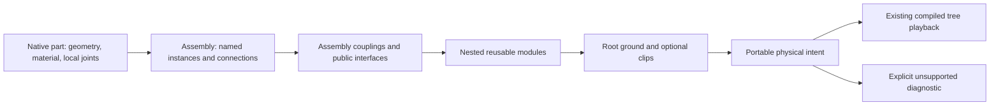

# Build123D parts and mechanisms

Tau uses Build123D 0.13 native shapes, materials and all five joint classes. `from tau_assembly import Assembly` adds a native `Compound` subclass that retains mechanical relationships. This module is supplied by Tau; it is not a released Build123D API. Native `connect_to` remains a one-time placement operation.

## Ownership



A part owns native joints and their local frames. An assembly owns connections between actual occurrences and affine coordinate couplings. Its public interface registry resolves descendant joints without changing their native owner or label. The root scene chooses ground and optional playback clips; nested modules do not add another global ground. Product containment and the rigid-body graph are separate: an assembly may contain multiple moving bodies.

## Python authoring

```python
from build123d import Axis, Box, Location, RevoluteJoint, RigidJoint
from tau_assembly import Assembly


def drive_module(*, angle=30):
    housing = Box(40, 40, 6)
    rotor = Box(20, 8, 4)
    cover = Box(40, 40, 1).locate(Location((0, 0, 3.5)))
    RevoluteJoint("shaft", housing, axis=Axis.Z, angular_range=(-2000, 2000))
    RigidJoint("mount", rotor)
    RigidJoint("mount", housing)
    RigidJoint("output", rotor)
    module = Assembly(children={"housing": housing, "rotor": rotor, "cover": cover},
                      base=housing, label="Drive")
    module.connect("drive", housing.joints["shaft"], rotor.joints["mount"], angle=angle)
    module.expose_joint("mount", housing.joints["mount"])
    module.expose_joint("output", rotor.joints["output"])
    return module
```

`Assembly.children` remains the native tuple. `Assembly.parts` is the read-only named child mapping; child names provide local occurrence identity. Repeated labels are presentation text. `Assembly.connections["drive"]` gives the explicit connection handle, independent of native `connected_to` being overwritten by another placement. Refer to coordinates with `(connection, "angle")`, `(connection, "distance")`, or `(connection, "x" | "y" | "z")` for Ball's final intrinsic XYZ chart.

`connect(name, source, target, **coordinates)` uses native joint placement and retains a named relationship. It refreshes affected native aggregate BReps so leaf preview and aggregate STEP geometry stay aligned. Use native `connect_to` directly when only one-time placement is intended; the preferred reusable mechanical API is `Assembly.connect`.

## Local passive-body ownership

`Assembly(children={...}, base=housing)` explicitly assigns otherwise unjointed passive descendants to the housing's rigid body. The base is a descendant occurrence, not a world anchor. A passive cover follows that housing while the module moves on a carrier; an articulated rotor retains its own body. Copies rebind the base reference into the copied tree.

The adapter does not infer a base from source/target order: native joint pairs can be reversed. It also does not infer a base from the mounting alias: a module can be mounted through its moving output. When passive ownership is ambiguous, supply `base` or group the passive geometry beneath a connected native `Compound`. Root `motion(model)["ground"]` remains the separate choice of a fixed world body. The API does not introduce live coordinate setters or a new solver.

## Assembly-owned couplings

Inside a module, after creating its native connections:

```python
module.couple(
    driver=(module.connections["input"], "angle"),
    follower=(module.connections["output"], "angle"),
    ratio=-2,
    offset=15,
)
```

This declares `q_output = -2 * q_input + 15` in authored native units. The initial native placement must satisfy the relationship. The adapter converts that relationship to deltas from the exported pose; it does not apply phase twice. Unknown coordinates, nonfinite values, conflicting followers, cycles and inconsistent reference phases fail admission. This is inspectable affine relationship data, not a Python callback, animation expression language or general mechanical solver.

## Safe public interfaces and copying

```python
from copy import copy, deepcopy

left = copy(prototype)
right = deepcopy(prototype)
# Parent owns only external connections, not the internal gearing.
machine.connect("left_mount", carrier.joints["left"], left.interfaces["mount"])
machine.connect("right_mount", carrier.joints["right"], right.interfaces["mount"])
```

`expose_joint(name, descendant_joint)` registers a resolving interface in `Assembly.interfaces`. Accessing it never inserts the endpoint into native `Shape.joints`. It remains attached to the moving descendant; mounting through a target interface moves its containing module coherently. External targets, stale descendants and duplicate names are rejected. This avoids the ownership transfer proposed by upstream Build123D's `JointDict` changes.

Fresh factory calls and `copy`/`deepcopy` produce independent occurrences. Copies rebind internal connections, couplings and interfaces into the copied tree. Retrieve handles from the copy (`right.connections[...]`), not the prototype. A repeated native object is not two occurrences; labels and BRep identity are not occurrence identity.

## Root presentation and migration

The optional module-level `motion(model)` hook now owns root `ground` and existing `animations`. New mechanical declarations belong in `Assembly`; old hook `connections`, `couplings` and `occurrence_ids` dictionaries are not the preferred or accepted replacement API. Native-only models remain supported through their retained joint pairs when no assembly records are available.

Clip keyframes reference `(connection, coordinate)` handles. **Author inputs are absolute native coordinates: degrees and millimetres.** The timeline shape (`id`, `duration`, `loop`, `keyframes`) is unchanged. A model authored at 30° can animate 30° → 390°; the emitted canonical keyframes are 0° → 360° deltas. This is an intentional migration of the unreleased hook: convert previous delta keyframes to absolute native values and convert prior metre distance values to millimetres. Do not silently reinterpret old numerical values.

The change keeps one author coordinate convention across native placement, mechanical relationships and presentation. There is no second motion framework. The worker recursively extracts assembly-owned mechanics before lowering to the existing kernel-neutral GLB profile. A root may drive a copied child's connection without redeclaring that child's internals.

## Coordinates and native compatibility

All canonical playback coordinates are deltas from the exported as-built state; Python authoring uses absolute native values as described above. Native reference coordinates are retained separately. Revolute reference direction is accounted for by native relative transforms; Tau does not reconstruct an older Build123D angle-reference implementation.

Ball input is **not** Tau's rotation-vector spherical joint. Native Build123D checks the intrinsic XYZ decomposition of `Rotation(input_angles) * angle_reference`. Tau retains that final composed chart, its three ranges and its reference state. Playback lowers it to three ordered revolute factors with as-built axes; reverse traversal reverses the factors and their axes. Sliders therefore show deltas in the final composed XYZ chart, not the original pre-reference Python input angles. This represents the native accepted orientations including near-singular chart states; Euler coordinates remain nonunique at a singularity.

Linear/revolute pairs lower to translation then rotation because their axes need not commute. Cylindrical pairs use the same ordered factors. Existing `@taucad/kinematics` rotation-vector spherical semantics and other kernels are unchanged. Infinite native ranges use omitted JSON bounds; infinity is never serialized. Controls use finite local scrub windows for unbounded travel while retaining the true limit in admission.

## Portable GLB contract

`TAU_cad_topology` remains container version 1:

- Component `placement` is a proper rigid local-to-model transform. `jointInterfaces` contains named local attachment frames, kernel-neutral kinds, ranges and reference information, even for unconnected parts.
- Attachment-frame columns name the joint's coordinate axes in the component coordinate basis. `placement * frame` locates that endpoint in the model. A Ball `referenceFrame` is relative to the attachment frame. Matrices are column-major; lengths are metres and model coordinates Y-up for Build123D GLBs.
- `mechanismIntent` retains assembly-owned endpoint references, the reference coordinates, coordinate chart, optional ground, and coupling/clip declarations. Endpoints resolve to component IDs and interface names, not labels or renderer indexes.
- Optional `mechanismIntent.rigidBodies` maps actual body component IDs to their owned component ID arrays. It preserves explicit base/passive ownership even when an unsupported graph has no compiled playback. The map may be partial when ownership is unresolved; diagnostics identify the gaps. Unknown IDs and duplicate membership are rejected. Older version-1 payloads may omit it; it is portable metadata, not another authoring API.
- The sibling `mechanism` is the compiled version-1 playback profile. Links own leaf component IDs; virtual links carry no geometry. Flat world-baked mesh nodes and topology-owned product hierarchy avoid applying ancestor placement twice.
- Valid unsupported connection graphs retain `mechanismIntent` and structured `mechanismDiagnostics`. Closed mechanical loops are not deleted or presented as supported playback. Product hierarchy cycles are invalid and rejected separately.

The shipped JSON Schema checks structural shape; `validateTauCadTopology` checks references, rigid frames, ranges, hierarchy cycles and playback admission. A physical graph without playback must carry an explicit unsupported diagnostic. Geometry remains viewable when the playback profile cannot represent the graph.

## Qualification and boundaries

The Python native matrix oracle and checked TypeScript fixtures compare the actual Tau evaluator with Build123D `relative_to`: five native classes, legal pair directions, nonzero reference, mixed-axis linear/revolute, nested rotations/translations, near-singular Ball states and unwrapped four turns. Additional tests cover distinct articulated modules on a moving parent, explicit identity across reordered labels, stale endpoints, durable repeated connections, unconnected interfaces and unsupported graphs.

This contract does not implement force dynamics, a general closed-loop solver, STEP AP242 mechanism entities, embedded source recovery, physical material properties, warehouse publication or other-kernel authoring redesign. Native STEP export remains geometry/assembly export; a GLB carrying mechanism intent is the motion-preserving interchange for this delivery. Alternate unit/frame exports must not claim intent preservation unless their complete metadata transformation has been qualified.

## Motion declaration admission

`@taucad/kinematics` exposes `validateMechanismMotion({ coordinates, couplings, animations })` for motion relationships whose physical graph is not supported by the current tree evaluator. It shares the coupling and clip checks used by `admitMechanism`: unknown coordinates, malformed values, coupling cycles, multiple drivers and invalid clip timing are rejected even when an unrelated physical graph diagnostic prevents playback. Valid unsupported physical intent remains inspectable. This validation does not claim to solve the graph or establish travel-bound feasibility. Native infinite range endpoints are allowed only on their unbounded side; `(Infinity, Infinity)` and `(-Infinity, -Infinity)` have no finite admissible coordinate and are rejected.
