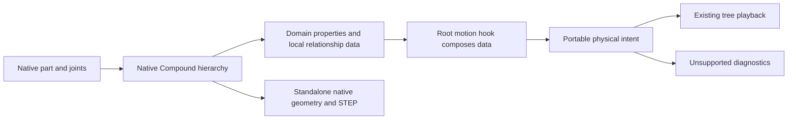

# Build123D parts and mechanisms

Models use Build123D 0.13 native shapes, finished materials and all five joint classes. Native `Compound`, factories and ordinary domain classes express reusable models. The 2026-10-17 operator ruling removes the former Tau Python Assembly supplement; it is not an authoring dependency. Native geometry and STEP export run outside Tau with the model's native dependencies.

## Kernel parity status

Parity means preserving the same portable meaning while using each kernel's native authoring idiom. It does not require identical author APIs or imply that all kernels implement every capability.

| Capability           | Implemented Build123D behavior                                                                                                              | Boundary                                                                                                                       |
| -------------------- | ------------------------------------------------------------------------------------------------------------------------------------------- | ------------------------------------------------------------------------------------------------------------------------------ |
| Parts and assemblies | Native shapes, `Compound`, fresh factories and domain classes; safe descendant joint properties                                             | Product containment alone does not establish rigid ownership; no Tau Python package                                            |
| Joints and motion    | Rigid, Revolute, Linear, Cylindrical and Ball native joints project into attachment interfaces, physical intent and supported tree playback | Couplings, grounding and clips use the plain-data hook because native connection history is incomplete; no general loop solver |
| Native appearance    | Native `Shape.material`, finished-material PBR, native normals/face UVs and embedded texture images in GLB                                  | Declare project texture files as dependencies; appearance does not deliver physical material properties                        |
| Curved BRep edges    | Edge polylines reuse the surface triangulation boundary; free curves use both chordal and angular tolerances                                | Valid seams remain visible; meshed lines approximate exact BRep edges                                                          |
| Interchange          | GLB preserves topology, hierarchy, appearance and mechanism intent; STEP preserves native geometry and assembly placement                   | STEP AP242 mechanism entities and embedded-source Restore are not delivered                                                    |

The shared extension preserves physical intent separately from its compiled playback profile. Replicad and the Pico kernels keep their current authoring APIs; redesigning those APIs or claiming their full joint/material parity is outside this delivery. The [kernel parity research owner](../research/kernel-parity-control-center.md) tracks broader cross-kernel work.

## Ownership



Native parts own their joint objects, local frames, materials and geometry. A connected native `Compound` can own passive geometry as a rigid body. Product grouping alone does not imply that all descendants are rigidly attached. Domain properties return actual descendant joints without changing their owner or label. A parent composes child mechanical data without repeating their ratios; root grounding is separate from local rigid grouping.

## Native authoring

Use native `connect_to` for placement before constructing final aggregate compounds. It keeps only limited latest-target history and does not solve motion. Fresh factory instances provide independent reusable models. Copying geometry alone does not prove arbitrary domain references/couplings rebound; resolve copied descendants and independently verify any copy recipe.

A local domain class can retain ordinary fields such as `housing`, `rotor` and a list of coupling dictionaries. These are application fields, not automatically discovered protocols. Root `motion(model)` explicitly reads and combines them. The [runnable native guide](../research/artifacts/build123d-kinematics-blueprint/api/index.md) carries common and repeated examples and distinguishes native construction from full worker/Desktop qualification.

## Safe descendant access and whole-module placement

A property such as `gearbox.mount` returns `gearbox.housing.joints["mount"]`. Do not assign that joint into another `.joints` dictionary: native ownership semantics may transfer it. Connecting to that descendant alone moves its parent, not the whole articulated module.

For a reusable compound and a native source/target pair, the desired model-space module location is:

```python
target_in_module = module.global_location.inverse() * target.parent.global_location
desired = source.parent.global_location * source.relative_to(target, **coordinates) * target_in_module.inverse()
parent = module.parent.global_location if module.parent else Location()
module.locate(parent.inverse() * desired)
```

Prefer completing all placement before constructing the final parent compound. If relocating an already aggregated hierarchy, refresh native ancestors bottom-up while preserving each ancestor's location; stale aggregate BRep is not acceptable even when leaf preview looks correct. `relative_to` records no connection, so retain that actual pair in the plain-data hook. This is an explicit native transform recipe, not a public Tau mounting framework.

## Plain-data motion hook

`motion(model)` accepts `ground`, `couplings`, `animations` and optional `connections`/`occurrence_ids`. No Tau Python import is required. When `connections` is supplied, it is the complete list including internal pairs; otherwise native retained pairs are inferred. Use `(source, target)` when final native state is sufficient, or `{"source": source, "target": target, "angle": 30}` with the native `angle`/`position`/`angles` keywords when a prior edge's reference was lost. The adapter verifies the supplied reference against final frames without moving author geometry. Unknown or stale endpoints and ambiguous references fail explicitly.

Coordinate selectors are `(native_joint, "angle" | "distance" | "x" | "y" | "z")`; `((source, target), coordinate)` disambiguates joints participating in multiple edges. `occurrence_ids` maps stable nonempty strings to actual returned shapes when structural paths are insufficient. Labels remain display text.

Placement, coupling offsets and clip values are absolute native degrees/millimetres. A 30°→390° clip exports 0°→360° deltas. Couplings specify `follower = ratio * driver + offset` and must match initial native placement. Ball x/y/z use the final composed intrinsic XYZ chart. Root composition is ordinary list unpacking; child ratios are authored once. The existing clip structure and canonical wire representation remain unchanged.

## Passive geometry

Group passive/static geometry beneath a connected native rigid `Compound`. Do not infer ownership from pair direction, a mounting alias or general product containment. Ambiguous ownership is diagnosed. There is no author-facing `base` or `rigid_bodies` convention; portable `mechanismIntent.rigidBodies` is translator output, not a second Python API.

## Coordinates and native compatibility

All canonical playback coordinates are deltas from the exported as-built state; Python authoring uses absolute native values as described above. Native reference coordinates are retained separately. Revolute reference direction is accounted for by native relative transforms; Tau does not reconstruct an older Build123D angle-reference implementation.

Ball input is **not** Tau's rotation-vector spherical joint. Native Build123D checks the intrinsic XYZ decomposition of `Rotation(input_angles) * angle_reference`. Tau retains that final composed chart, its three ranges and its reference state. Playback lowers it to three ordered revolute factors with as-built axes; reverse traversal reverses the factors and their axes. Sliders therefore show deltas in the final composed XYZ chart, not the original pre-reference Python input angles. This represents the native accepted orientations including near-singular chart states; Euler coordinates remain nonunique at a singularity.

Linear/revolute pairs lower to translation then rotation because their axes need not commute. Cylindrical pairs use the same ordered factors. Existing `@taucad/kinematics` rotation-vector spherical semantics and other kernels are unchanged. Infinite native ranges use omitted JSON bounds; infinity is never serialized. Controls use finite local scrub windows for unbounded travel while retaining the true limit in admission.

## Portable GLB contract

`TAU_cad_topology` remains container version 1:

- Component `placement` is a proper rigid local-to-model transform. `jointInterfaces` contains named local attachment frames, kernel-neutral kinds, ranges and reference information, even for unconnected parts.
- Attachment-frame columns name the joint's coordinate axes in the component coordinate basis. `placement * frame` locates that endpoint in the model. A Ball `referenceFrame` is relative to the attachment frame. Matrices are column-major; lengths are metres and model coordinates Y-up for Build123D GLBs.
- `mechanismIntent` retains native endpoint references, the reference coordinates, coordinate chart, optional ground, and coupling/clip declarations. Endpoints resolve to component IDs and interface names, not labels or renderer indexes.
- Optional `mechanismIntent.rigidBodies` maps actual body component IDs to their owned component ID arrays. It preserves native rigid-compound ownership even when an unsupported graph has no compiled playback. The map may be partial when ownership is unresolved; diagnostics identify the gaps. Unknown IDs and duplicate membership are rejected. Older version-1 payloads may omit it; it is portable metadata, not another authoring API.
- The sibling `mechanism` is the compiled version-1 playback profile. Links own leaf component IDs; virtual links carry no geometry. Flat world-baked mesh nodes and topology-owned product hierarchy avoid applying ancestor placement twice.
- Valid unsupported connection graphs retain `mechanismIntent` and structured `mechanismDiagnostics`. Closed mechanical loops are not deleted or presented as supported playback. Product hierarchy cycles are invalid and rejected separately.

The shipped JSON Schema checks structural shape; `validateTauCadTopology` checks references, rigid frames, ranges, hierarchy cycles and playback admission. A physical graph without playback must carry an explicit unsupported diagnostic. Geometry remains viewable when the playback profile cannot represent the graph.

## Qualification and boundaries

The Python native matrix oracle and checked TypeScript fixtures compare the actual Tau evaluator with Build123D `relative_to`: five native classes, legal pair directions, nonzero reference, mixed-axis linear/revolute, nested rotations/translations, near-singular Ball states and unwrapped four turns. Additional tests cover distinct articulated modules on a moving parent, explicit identity across reordered labels, stale endpoints, explicit repeated connections, unconnected interfaces and unsupported graphs.

The edge-alignment correction is qualified by independent emitted-triangle boundary tests at multiple tolerances, nested placements, free curves, missing face polygons, sphere/cone poles and budget retries. The sealed Python suite passes 69 tests with 100% line and branch coverage. Targeted native GLB/STEP and planetary tests pass. Rebuilt Desktop verification preserves the continuous hub tangent edge and aligned curved borders, while four playback poses retain pin coincidence and the 48 mm orbit. These checks establish this Build123D implementation, not universal parity across kernels.

This contract does not implement force dynamics, a general closed-loop solver, STEP AP242 mechanism entities, embedded source recovery, physical material properties, warehouse publication or other-kernel authoring redesign. Native STEP export remains geometry/assembly export; a GLB carrying mechanism intent is the motion-preserving interchange for this delivery. Alternate unit/frame exports must not claim intent preservation unless their complete metadata transformation has been qualified.

## Motion declaration admission

`@taucad/kinematics` exposes `validateMechanismMotion({ coordinates, couplings, animations })` for motion relationships whose physical graph is not supported by the current tree evaluator. It shares the coupling and clip checks used by `admitMechanism`: unknown coordinates, malformed values, coupling cycles, multiple drivers and invalid clip timing are rejected even when an unrelated physical graph diagnostic prevents playback. Valid unsupported physical intent remains inspectable. This validation does not claim to solve the graph or establish travel-bound feasibility. Native infinite range endpoints are allowed only on their unbounded side; `(Infinity, Infinity)` and `(-Infinity, -Infinity)` have no finite admissible coordinate and are rejected.
