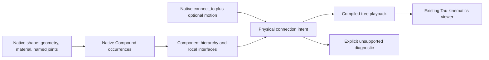

# Build123D parts and mechanisms

Tau uses Build123D 0.13 native `Shape`, `Compound`, the five native joint classes and `connect_to`. A model returns native geometry. No Tau part wrapper or replacement joint classes are required. A Tau-specific optional `motion(model)` hook supplies assembly intent that released Build123D does not retain: durable connection pairs, stable occurrence names, ground, couplings and animation clips.

## Ownership



A shape owns reusable named attachment interfaces, including interfaces that are not connected. An assembly owns connections between actual occurrences. Product containment and the rigid-body graph are separate: an assembly can contain several moving bodies. A static descendant belongs to its nearest connected ancestor body. A body nested inside a connected compound inherits that compound's mounting motion; it does not acquire a second global ground.

Build123D `connected_to` is a one-way last-connection pointer. Tau scans those retained pointers. `motion(model)["connections"]` can retain additional native `(source_joint, target_joint)` pairs. It does not create or solve constraints. Create or copy parts first, place them, and connect the final instances. External endpoints, copied stale targets and ambiguous joint references are rejected. Moving an endpoint after connection without preserving its mate produces an explicit unsupported diagnostic.

## Minimal authoring supplement

```python
from build123d import Axis, Box, Compound, RevoluteJoint, RigidJoint


def main(params):
    housing = Box(20, 20, 10)
    rotor = Box(12, 3, 3)
    RevoluteJoint("shaft", housing, axis=Axis.Z, angular_range=(-2000, 2000))
    RigidJoint("mount", rotor)
    housing.joints["shaft"].connect_to(rotor.joints["mount"], angle=22.5)
    return Compound(children=[housing, rotor])


def motion(model):
    housing, rotor = model.children
    shaft = housing.joints["shaft"]
    return {
        "ground": housing,
        "occurrence_ids": {"housing": housing, "rotor": rotor},
        "animations": [{
            "id": "spin", "duration": 4, "loop": "repeat",
            "keyframes": [
                {"time": 0, "coordinates": {shaft: 0}},
                {"time": 4, "coordinates": {shaft: 1440}},
            ],
        }],
    }
```

`motion` is Tau's integration hook, not a released Build123D API. Plain native connections work without the hook when the root is unambiguous. `ground` can name either side of a native connection: playback orients the graph without changing native coordinate signs or bounds.

`occurrence_ids` maps nonempty stable strings to distinct returned native objects. These IDs survive label changes and sibling reordering. Without them, structural path IDs are deterministic across identical structure and relabeling, but do not promise stability across reordering. Labels are display text; geometry hashes and GLTF node indices are not identity.

For a coupling, use `{"driver": shaft, "follower": other_shaft, "ratio": -2}`. For a multi-coordinate pair use `(joint, "angle")`, `(joint, "distance")`, or the Ball chart's `(joint, "x")`, `"y"`, `"z"`. An endpoint reused across several retained connections is ambiguous and cannot be used as a bare motion reference. Clips use the existing duration, loop and keyframe structure.

## Public assembly interfaces

A native compound can expose a moving descendant endpoint without leaking its child layout:

```python
module.joints["output"] = rotor.joints["output"]
module.joints["output"].connect_to(tool.joints["mount"])
```

Tau exports this mapping as `jointInterfaceAliases`, resolving to the actual descendant component and its local interface. The endpoint follows the rotor's motion; it is not copied into the stationary compound frame. Aliases outside the owning compound's descendant tree are rejected. This uses Build123D's existing joint dictionary and actual joint objects, with no Tau alias class.

## Coordinates and native compatibility

All playback coordinates are deltas from the exported as-built state. Native reference coordinates are retained separately. Revolute reference direction is accounted for by native relative transforms; Tau does not reconstruct an older Build123D angle-reference implementation.

Ball input is **not** Tau's rotation-vector spherical joint. Native Build123D checks the intrinsic XYZ decomposition of `Rotation(input_angles) * angle_reference`. Tau retains that final composed chart, its three ranges and its reference state. Playback lowers it to three ordered revolute factors with as-built axes; reverse traversal reverses the factors and their axes. Sliders therefore show deltas in the final composed XYZ chart, not the original pre-reference Python input angles. This represents the native accepted orientations including near-singular chart states; Euler coordinates remain nonunique at a singularity.

Linear/revolute pairs lower to translation then rotation because their axes need not commute. Cylindrical pairs use the same ordered factors. Existing `@taucad/kinematics` rotation-vector spherical semantics and other kernels are unchanged. Infinite native ranges use omitted JSON bounds; infinity is never serialized. Controls use finite local scrub windows for unbounded travel while retaining the true limit in admission.

## Portable GLB contract

`TAU_cad_topology` remains container version 1:

- Component `placement` is a proper rigid local-to-model transform. `jointInterfaces` contains named local attachment frames, kernel-neutral kinds, ranges and reference information, even for unconnected parts.
- Attachment-frame columns name the joint's coordinate axes in the component coordinate basis. `placement * frame` locates that endpoint in the model. A Ball `referenceFrame` is relative to the attachment frame. Matrices are column-major; lengths are metres and model coordinates Y-up for Build123D GLBs.
- `mechanismIntent` retains assembly-owned endpoint references, the reference coordinates, coordinate chart, optional ground, and coupling/clip declarations. Endpoints resolve to component IDs and interface names, not labels or renderer indexes.
- The sibling `mechanism` is the compiled version-1 playback profile. Links own leaf component IDs; virtual links carry no geometry. Flat world-baked mesh nodes and topology-owned product hierarchy avoid applying ancestor placement twice.
- Valid unsupported connection graphs retain `mechanismIntent` and structured `mechanismDiagnostics`. Closed mechanical loops are not deleted or presented as supported playback. Product hierarchy cycles are invalid and rejected separately.

The shipped JSON Schema checks structural shape; `validateTauCadTopology` checks references, rigid frames, ranges, hierarchy cycles and playback admission. A physical graph without playback must carry an explicit unsupported diagnostic. Geometry remains viewable when the playback profile cannot represent the graph.

## Qualification and boundaries

The Python native matrix oracle and checked TypeScript fixtures compare the actual Tau evaluator with Build123D `relative_to`: five native classes, legal pair directions, nonzero reference, mixed-axis linear/revolute, nested rotations/translations, near-singular Ball states and unwrapped four turns. Additional tests cover distinct articulated modules on a moving parent, explicit identity across reordered labels, stale endpoints, durable repeated connections, unconnected interfaces and unsupported graphs.

This contract does not implement force dynamics, a general closed-loop solver, STEP AP242 mechanism entities, embedded source recovery, physical material properties, warehouse publication or other-kernel authoring redesign. Native STEP export remains geometry/assembly export; a GLB carrying mechanism intent is the motion-preserving interchange for this delivery. Alternate unit/frame exports must not claim intent preservation unless their complete metadata transformation has been qualified.
