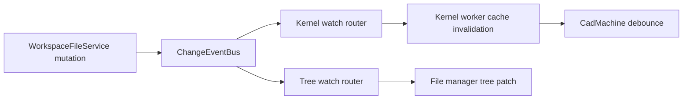

# Filesystem Policy

Internal reference for filesystem access, data transfer, caching, and concurrency in the Tau application. Applies to all code that reads or writes user project data, cache files, or metadata through the file-manager worker's provider stack. Topology — authority, providers, mounts, discovery, cross-tab coherence — lives in `docs/policy/filesystem-authority-policy.md`.

The write, metadata, large-object and budget rules state what the [filesystem capability redesign](../research/filesystem-capability-redesign.md) shipped (W0–W12; design in its [North Star](../research/filesystem-capability-north-star.md)). Where a rule implements one of that charter's decisions it cites it as `D<n>`.

## Rationale

A single-writer topology with zero-copy binary transfer and bounded caches prevents backend index corruption and memory bloat. Separate kernel and UI watch planes avoid coupling render invalidation to tree refresh, and explicit overflow handling ensures deterministic behavior under load.

## Core Principles

1. **Registry-owned providers, one mutation authority** — `ProviderRegistry` is the sole provider owner; non-owning mounts only route; all mutations flow through `WorkspaceFileService` queues
2. **Transfer only owned binary buffers** — use transfer lists for disposable boundary-owned bytes; clone borrowed provider storage before transfer so reads never detach authority state
3. **Lazy loading over eager recursion** — never traverse a directory tree deeper than the consumer needs
4. **Bounded caches** — every in-memory cache must have an eviction policy (TTL, max size, or LRU)
5. **Debounce refresh, don't spam** — background tree refreshes must be debounced; rapid mutations must coalesce
6. **Kernel watcher fast path first** — file change -> kernel invalidation must not route through `use-project.tsx` fanout
7. **Server-side watch matching** — path/include/exclude matching happens in the worker, not in clients; do not expose unused event-kind filters
8. **Loss-aware event streams** — watcher overflow/dropped-event conditions must trigger explicit resync behavior
9. **Bridge skip-originator is internal** — when a filesystem bridge port initiates a mutation, the resulting `ChangeEvent` may carry an originating port id for intra-process routing only (`tagEventOrigin` / `getEventOrigin` on `@taucad/filesystem`). The filesystem bridge adapter (`@taucad/fs-bridge` `exposeFileSystem`) skips delivering `fileChanged` back to that port. This metadata is **not** part of the wire shape of `ChangeEvent`, is **not** passed as a second argument to `ChangeEventBus.emit`, and **must not** surface in consumer-facing UI APIs.
10. **Filesystem transport reports facts, not project recency** — filesystem APIs emit typed content-change facts; project-domain participants and machines decide whether those facts are activity.
11. **Virtual routes are projections, not physical identity** — `/projects/<id>` resolves through a persisted locator; provider paths come from `{ storageRootKey, providerBasePath }`, never from manifest fields.
12. **Runtime reachability is filesystem-owned** — issue one rooted view with full authored-data writes per selected project; runtime receives only that filesystem and local paths. Host-record protection is the narrow exception owned by filesystem authority Rule 15.

## Bridge self-write suppression (skip-originator)

Self-write suppression (so an editor port does not receive its own `fileChanged` echo) is enforced in `libs/fs-bridge` at `filesystem-bridge.exposeFileSystem`: `deliverToHandles` reads the origin via `getEventOrigin(event)` and skips the recipient whose port id matches.

- **Author boundary:** `WorkspaceFileService` mutating methods accept optional `context?: { originClientId?: string }`. Context is bound at port-connect time via `bindMutationContextForPort` (in `filesystem-bridge.ts`), which wraps each connection's handler with a per-port closure that injects `{ originClientId: portId }` as the trailing argument on every mutating call. Before `ChangeEventBus.emit(event)`, the worker calls `tagEventOrigin(event, id)` when context is present. The bridge primitive (`createBridgeServer`) is unaware of context — it dispatches user args verbatim.
- **Merge rule:** `EventCoalescer` / `coalesceChangeEvents` reads origins via `getEventOrigin` so mixed-origin batches clear the tag (every port receives the merged event), matching the blueprint Finding 14 rule.
- **Forwarders:** `ChangeEventBus` and `WatchRegistry` do not take a parallel `originClientId` parameter; the event object is the sole carrier.
- **Registry:** `packages/filesystem/src/event-origin-registry.ts` stores origin metadata in a `WeakMap`; coalescing creates an untagged survivor when the merged path history has mixed origins.

For rationale and alternatives considered, see [`docs/research/origin-client-id-propagation-audit.md`](../research/origin-client-id-propagation-audit.md).

```text
File manager worker: WorkspaceFileService + MountTable + providers
  │
  ├─ workspaceBridgeService(service) ── UNROOTED protocol v2
  │    topology and lifecycle (9 methods)
  │    scope-required reads: readScopedFile, readScopedShallowDirectory,
  │                          getScopedZippedDirectory
  │
  └─ handlerForRoot(root, consumer) ─── ROOTED protocol v2
       user          → composeView(..., { consumer: 'user' })
       agent         → composeView(..., { consumer: 'agent' })
       working-copy  → captured raw rooted filesystem (trusted composition only)
       per-path content, mutations, search, statTree and watch
```

All browser filesystem I/O runs on the file manager worker. `workspaceBridgeService(service)` alone decides the unrooted authority wire: nine topology, project-lifecycle, polling and teardown methods plus the three scope-required reads named above. It exposes no per-path content call. Serve every per-path content call from a rooted connection.

Every rooted bridge open names its `root` and `consumer` (`'user'`, `'agent'` or `'working-copy'`). Protocol version 2 requires the consumer and fails closed before `handlerForRoot` when the field is absent, unknown or paired with the wrong protocol version. The UI filesystem client owns and reuses connections by `(root, consumer)` so a raw working-copy connection cannot stand in for a masked connection. Only a `'user'` connection composes the system skills overlay at `.agents/skills`: the page's `'agent'` connections serve executors of project code, which never see it, and the agent's tools compose it themselves over `'working-copy'`.

A host states one `PathPolicy`, beside `handlerForRoot` on `exposeFileSystem` and beside `allowRoot` on `serveNodeFsProvider`; both are required. The bridge rebases it on the connection's root and hands it to `handlerForRoot`, so the view a masked consumer reads and the change stream it hears are masked by the same object. Hosts do not compute a second `policyAtRoot` of their own.

`serveNodeFsProvider` returns the served owner, `NodeFsServer { run, close }`. `close` is the disposer. `run` is for trusted in-process host composition only, never a renderer port: it holds one admitted root's whole-root `NodeFsAuthorityHost` claim and hands the operation a scope of rooted reads, checked file writes and the checked entry operations `renameChecked`, `mkdirChecked` and `rmdirChecked`. The scope is the unmasked rooted primitive, so a caller that publishes into it owns its own protected-path refusal. A caller never awaits a wire mutation of the same root inside `run`; that waits on the held claim forever.

Open the `'agent'` view for agent tools and every executor of agent-authored project code: the kernel runtime, GeoSpec runner, Quick Look runtime, host-daemon runtime child and desktop `runtimeFileSystem` route. This view is defence in depth, not a sandbox: Node and desktop execute a real Node module that can import `node:fs`, and a browser worker can reach browser storage APIs directly. Use an OS or container sandbox when project code is adversarial.

## Rooted runtime filesystem rules

### Rule 0a: Canonicalize before routing or provider I/O

Use the path grammar owned by the boundary. Authority routing uses `resolveAuthorityPath` and canonical absolute POSIX paths such as `/projects/<id>/main.ts`. An already-rooted filesystem capability uses `assertRootedPath` for canonical inputs and `resolveRootedPath` when normalization is explicitly part of the API; its root is `''`, and descendants such as `main.ts` never have a leading slash. Both grammars reject URLs, backslashes, drive-like paths, control characters, and traversal above their root. Host adapters translate rooted paths to native paths privately after validation.

### Rule 0b: Capture one exact mount for each rooted view

`createRootedFileSystem(authorityRoot)` resolves the selected mount once and captures its provider and base path. Every operation joins a canonical local path to that captured base directly; it must not call the global mount table again. If the mount is replaced, reject later admissions with `ESTALE` instead of silently switching storage. Rename validates both local operands before either provider call.

### Rule 0c: Preserve full write and watch semantics inside the view

A rooted view supports the same authored-data writes, queues, cache invalidation, persistence, and events as global WFS operations. Do not add cache-only writes, read-only source trees, or generic path allowlists. Apply only the canonical host-record protection in [filesystem authority Rule 15](filesystem-authority-policy.md#15-rooted-views-are-the-runtime-reachability-boundary), covering all mutation routes without duplicating its ownership rules here. Rebase watch requests and emitted events to the capability-local namespace (`''`, `main.ts`, `lib/part.ts`), and never deliver sibling-project events. Scoped runtime bridges receive file bytes only by transfer or copy through rooted RPC dispatch; there is no shared file pool, and none may be added that a read could hit without that dispatch.

A rooted view preserves the exact canonical virtual paths carried by concrete create, change, delete, and rename events regardless of backing-filesystem naming semantics. It must not lowercase, normalize Unicode, infer aliases, or widen a concrete event to `reset`. Only explicit information-loss signals—such as overflow, observer `unknown`/`errored`, stale-root detection, backend replacement, or an irreducibly summarized change—use reset recovery. Preserve the hidden mutation origin through rooted writes and suppress only the originating scoped port's echo.

Every admitted operation retains the exact captured mount entry through provider I/O and every resulting cache, tree, event, and watch side effect. After suspension, do not attribute old-provider work to a replacement or nested route. Cross-tab facts carry the existing physical identity `{ storageRootKey, providerBasePath }` and refresh only a matching projection before delivery.

Mask watches per consumer. Before a recursive `rmdir`, `move`, `rename` or `bulkMove`, walk the affected subtree and refuse hidden paths at the view root for every consumer. Below the root, refuse hidden descendants for an `'agent'` view; a `'user'` view may remove or move a vendored directory that contains its own nested control store.

The Node provider must refuse with `ELOOP` when a visible name resolves through a symlink onto a hidden real path, and `readdir` must drop that entry. Archive one file at a time and refuse with `ARCHIVE_TOO_LARGE` when the default 256 MiB byte ceiling would be crossed.

## Read Rules

### Rule 1: Shallow reads by default

Always read a single directory level unless the consumer provably needs deep recursion.

Deep reads are permitted only for: the rooted `contents` and `archive` content operations (ZIP/copy), startup-only `statTree` hydration, and `readFiles` (kernel dependency batch). Deep reads are forbidden in mutation-triggered refresh paths.

### Rule 2: Parallel stat, sequential traversal

When listing a single directory, `readdir` + parallel `Promise.all(stat(...))` is preferred over sequential `stat` calls. Recursive traversal (when needed) should be sequential at the directory level to avoid overwhelming the storage backend.

**Backend performance context:** IndexedDB transaction creation has fixed overhead (~0.1–0.3ms each) regardless of payload size. Parallelizing stat calls within a directory lets the browser pipeline IDB transactions instead of sequentially awaiting each one.

**For metadata-only queries (tree display, file counts):** Prefer the root's Project Index over provider stat calls. See Rule 33.

### Rule 3: Read caching expectations

| Layer                    | Cache                          | Eviction                      | Notes                                       |
| ------------------------ | ------------------------------ | ----------------------------- | ------------------------------------------- |
| File manager `openFiles` | `Map<path, Uint8Array>`        | Must have max size + TTL      | Stores recently accessed file contents      |
| Editor document session  | Background document map        | LRU, max 10 clean documents   | Held, dirty and saving documents stay owned |
| Kernel geometry cache    | `.tau/cache/geometry/*.bin`    | Max age + max entries         | MessagePack serialized meshes               |
| Kernel parameter cache   | `.tau/cache/parameters/*.json` | None currently                | JSON parameter snapshots                    |
| Standalone providers     | Per storage root               | Must be reused, not recreated | `filesystem-authority-policy.md` Rules 8/14 |

### Rule 4: File size awareness

Source files are typically <100 KB. Binary CAD files (STL, STEP, glTF) can be 10-100 MB. All read paths must handle large binaries without blocking the event loop:

- Kernel file reads transfer via `ArrayBuffer` transfer lists (zero-copy)
- Main thread reads should avoid storing large binaries in `openFiles`
- Future: streaming reads for files > 1 MB

### Rule 4a: Content resolution and metadata stay truthful

Content-facing UI facades resolve files to an explicit discriminated state such as loading, text, binary, too-large, orphaned, or error. Detect binary content from a bounded byte prefix with BOM and NUL handling rather than from a filename extension. Byte-only consumers use the typed byte-resolution path and receive typed failures instead of an unresolved loading state.

A bounded content cache reports whether `set` admitted the value, keys entries by canonical path, and exposes entries for targeted prefix eviction. It must not silently discard an oversized value. File-tree rows carry provider-derived size and time metadata; consumers must not invent zero sizes or current timestamps.

Normalize `''` and `/` to the same selected workspace root at the RPC tool-input boundary. Never delete an entire browser database as error recovery when it may contain user work; repair or remove the affected authority record under the provider's transaction rules.

## Write Rules

### Rule 5: One lock set per changeset

Every authored-data mutation (`writeFile`, `writeFiles`, `appendFile`, `mkdir`, `rename`, `unlink`, `rmdir`, copies, imports, checkout and pull apply) is a changeset through `MutationPipeline.apply` (D2, D3). Admit every entry before the first I/O, stage stream-backed entries before any lock is requested, then take **one lock set, once**, and hold it for every phase. The lock set is built per path from its **physical** hierarchy up to the provider base path — the path itself exclusive, each ancestor shared — plus the owning project's `project:<id>` token, shared. A changeset that writes, moves or removes a directory holds that directory exclusively, so a changeset inside it waits. Only a lifecycle changeset (project create, delete, adoption, topology replacement) takes the project token exclusively: a fence. A physical mount holds no logical tokens; a mount without physical identity holds its logical hierarchy up to its mount prefix. Tokens are deduplicated, requested in sorted order with `navigator.locks` (`tau-fs-write:` prefix), and ordered within the tab by `ResourceQueue` on the same tokens. Mount resolution keeps `storageRootKey`, `providerBasePath` and the provider path, so a mounted route and a named authority operation on the same bytes take the same token. Named project operations also take their logical-project token.

Bound each changeset to `maximumChangesetEntries` (256) entries and `maximumChangesetBytes` (32 MiB) of bytes in hand, so a save waits on a bulk writer for at most one changeset. Never hold a lock across network I/O or across a consumer-supplied stream (I11): stage first, publish under the lock.

Generic scoped mutation APIs are forbidden. Ordinary mutation uses a mounted authority path; only the named project commit and permanent-delete operations may mutate an unmounted physical locator, after re-establishing identity under the shared physical lock.

**Why**: Two changesets conflict only when they write the same path or one replaces a directory the other is inside. A save during a 2,000-file checkout then waits on its own file, not on the checkout (S17), while a logical route and a physical locator for the same bytes still serialise.

If a future backend reintroduces parent-directory read-modify-write metadata, use the parent directory as the queue key for that backend. Do not reintroduce a global write queue or a project-exclusive lock for ordinary writes.

### Rule 5a: The changeset is the only mutation

The changeset is the mutation primitive (D2). A single-file write is a changeset of one, and the rooted convenience methods coalesce the calls one task issues into one changeset (D22; do not await a mutation convenience inside a loop). The per-resource guarantees (path normalisation, mount and backend resolution, mask, lock, writer-owned cache invalidation, Project Index update, exact event and origin metadata) are properties of the whole changeset. They are not reached by looping a per-file primitive. A changeset runs in up to three ordered phases, and a later phase starts only after every entry of the earlier one is durable, so completion markers (`tau.json`) go last. Each phase goes to its providers' `applyBatch` (Rule 34). The committed changeset publishes exactly one change set per port (D6, Rule 19a) and one cross-tab notice (Rule 25). A record-log append is an `append` entry carrying its `fence`, checked under the changeset's lock set (D23).

Control-plane bytes are not changesets. `.git/**` objects, packs and refs go through the rooted private store: no locks beyond ref compare-and-swap and the repack fence, no events, no index, no metadata (D7, I6). The authority is their only writer.

Delivery coalescers may batch exact mutation facts after commit, and may merge the change sets of one delivery window into one (D6). They must not replace affected paths with a lossy root-directory summary. A merge that cannot stay exact (an entry bound, or a member that already carries a reset) becomes an explicit `ChangeSetReset` scoped to the common ancestor of everything it merged, never a silent truncation. Merging keeps order where order carries meaning: moves stay in place, and a deleted directory is never folded into a later create at the same path, so a consumer still learns the old directory's descendants are gone. When one changeset replaces two watched ancestors, the reset covers both.

**Why**: Per-file mutations each took the project lock, refreshed the provider and emitted an event. A 2,000-file apply became about 4,000 serialised mutations (485 s on the reference fixture, against 11.6 s once it was a few changesets).

Receipts must be truthful. Report every entry's outcome (`applied`, `failed`, `uncertain`, or `skipped` when an earlier phase failed or the call was aborted), and invalidate every resource whose commit state may have changed. A changeset may be partially applied, but it never reports success for an entry that is not durable (I1). Never claim atomicity across entries, reverse completed entries with an overwrite rollback, or reject while sibling entries continue in the background. A caller that sees a potentially applied changeset (Rule 32) re-reads what it changed before it retries.

### Rule 5b: Provider projections change only after durable commit

Providers that maintain in-memory path, directory, size, mtime, or content-metadata projections update them only after the backing mutation commits. `FileSystemAccessProvider` aborts the writable stream when write or close fails. `DirectIdbProvider` performs same-store file rename as one put+delete transaction and stages write and rename projection changes until transaction completion. A failed or aborted transaction leaves the prior projection intact; if commit state is uncertain, rehydrate before serving another metadata read.

**Why**: Mutating the projection before durable completion turns a failed write into a false successful `stat`/`readdir`, which is data corruption at the API boundary.

### Rule 5c: Providers expose one valid path tree

Every provider must independently enforce one entry kind per canonical path. A file cannot be an ancestor or directory, `mkdir` cannot replace a file, `writeFile` cannot replace a directory, and `unlink`/`rmdir` must reject the wrong kind. Exact self-rename is a no-op; moving a directory beneath itself fails before mutation. A persistent provider must preserve explicit empty directories across reopen.

All fallible validation and serialization for a destructive multi-path ingress completes before the first provider mutation. Use an inline `Set` parent walk for small payload preflights; do not add a trie or second metadata authority.

Provider-native transactional artifacts are not virtual filesystem entries. Filter browser artifacts such as Chromium `.crswap` files inside `FileSystemAccessProvider` before directory snapshots, indexes, watches, RPC, or UI consumers observe them. Do not duplicate this filtering in generic consumers.

### Rule 6: Transfer only bytes owned by the sending boundary

Use `extractTransferables` when the sending boundary owns a disposable byte buffer. If a provider, cache, or caller retains the bytes, clone once at the boundary and transfer that owned clone. The transferred buffer is detached; no retained state may reference it.

### Rule 7: Mutation → targeted invalidation

After a mutation (delete, rename, upload), invalidate only the parent directory of the affected path, not the entire tree. The caller must provide the affected path so the UI can selectively refresh.

### Rule 7a: No project-recency flags in filesystem APIs

Filesystem packages and UI file facades must not accept options that decide whether `ProjectLibraryState.lastActivityAt` changes. They should emit precise events (`written`, `batchWritten`, `fileCopied`, `directoryCopied`, `renamed`, `deleted`, etc.) with workspace-relative affected paths. The project route participant forwards those facts to `project.machine`, and the project machine applies the content-path classifier and owns the activity decision.

**Why**: A filesystem layer cannot distinguish navigation repair, derived metadata, hydration, housekeeping, and user-visible content activity reliably after intent has been erased. Pushing project recency into file APIs creates per-callsite debate and reintroduces recent-project list jumps.

### Rule 7b: System-artifact visibility is a UI projection

`tau.json`, `thumbnail.webp`, and `.tau/**` are real filesystem entries and remain readable through ordinary APIs. File-tree presentation may hide or decorate them as system artifacts, but must do so in its projection layer. Providers, discovery, copy/export, and publication code must not pretend these files do not exist; callers that omit them do so through explicit artifact filters. Control-plane exclusion (`.git/**`, `.tau/revisions/**`, the rest of the registry's `hidden` class) is structural — every composed view refuses it (authority policy Rule 16) — while records and cache exclusion, such as a whole-project export carrying only `versioned` bytes, is an explicit caller filter.

## Tree Refresh Rules

### Rule 8: Debounce background refresh

The `spawnBackgroundRefresh` actor (triggered by `fileWritten`, `fileRenamed`, `fileDeleted`) must be debounced. Rapid mutations (AI code streaming, batch imports) should coalesce into a single refresh after the burst settles.

Recommended debounce: 300-500ms after the last mutation event. VS Code uses 500ms.

### Rule 9: Deduplication via in-flight map

Use a synchronous `Map<key, Promise>` (not React state) to deduplicate concurrent requests for the same directory. This prevents race conditions across render cycles.

### Rule 10: Error recovery on expand

If a directory load fails, do not cache the failure. Allow retry on the next expand attempt. Optionally collapse the failed node (VS Code pattern).

## Backend & Provider Rules (moved)

Former Rules 11–13e (backend isolation, standalone instance safety and reuse, webaccess handle lifecycle, backend downgrade, workspace binding, creation transaction, root FM pinning, provider cache keying) live in `docs/policy/filesystem-authority-policy.md`, which also states the single-filesystem-authority invariant they serve; a rule-number mapping table there resolves old citations. The ZenFS-era mechanics formerly prescribed by Rules 11–12 (`resolveMountConfig`, full-data mount preload) are retired — the live architecture is `MountTable` + `ProviderRegistry` + direct providers.

## RPC Pattern Rules

### Rule 14: Promise-based RPC for filesystem operations

Use `await proxy.method()` (promise-based RPC) for all standard filesystem operations. This is the correct pattern because FS operations are inherently request/response: one call, one result, no intermediate state.

VS Code confirms this — `DiskFileSystemProviderClient` uses `channel.call()` (returns `Promise<T>`) for `stat`, `readFile`, `readdir`, `writeFile`, and all other one-shot operations. Event-driven patterns (`channel.listen()`) are reserved for streaming and subscriptions.

Do not convert FS RPC to fire-and-forget or event-driven patterns unless the operation has intermediate results (streaming) or is a long-lived subscription (file watching).

```typescript
// CORRECT: Promise-based for one-shot operations
const stat = await proxy.stat(path);
const content = await proxy.readFile(path, 'utf8');
await proxy.writeFile(path, data);

// CORRECT: Event-driven for push notifications (future)
bridge.listen('treeChanged', (event) => {
  /* update UI */
});

// INCORRECT: Event-driven for simple reads (unnecessary complexity)
bridge.send({ type: 'readFile', requestId, path });
bridge.onMessage((msg) => {
  if (msg.requestId === requestId) resolve(msg.result);
});
```

### Rule 15: Event channels for push notifications (target)

For worker-to-main-thread push notifications (directory tree changes, file watching events), extend the bridge with an event channel alongside the existing RPC. This is a `listen()`-style subscription, not a replacement for `call()`.

Use cases: `treeChanged` events, batch operation progress, large file streaming.

## Watcher Architecture Rules

### Rule 18: Two watch planes with different goals

Implement and maintain two distinct watch planes:

- **Kernel fast path (primary)**: dependency-scoped file watchers used by kernel workers to invalidate render caches and emit `filesChanged`.
- **UI tree path (secondary)**: directory-scoped watchers used to incrementally update tree state.

Do not mix these planes into a single coarse "watch everything" stream.

Both planes, and every other consumer on the hot write path (the Files tree and open documents through `WorkerChangeChannel`, a kernel's dependency watch through the runtime's worker-filesystem proxy, and the agent host's chat-log observation), register in the change-set form (Rule 19a), so an agent turn of fifty writes reaches each consumer once rather than fifty times. The per-path form remains for a source that answers the change-set form with `ENOTSUP`.



### Rule 19: Watch API contract is first-class and explicit

`WorkspaceFileService.watch(...)` must support an explicit request contract:

- `paths`: absolute normalized watch roots
- `recursive`: default `false`
- `includes`: optional include patterns
- `excludes`: optional exclude patterns

`watch()` must return an unsubscribe function (`() => void`) and be wrappable into `Disposable` via `toDisposable`, per `library-api-policy.md`.

### Rule 19a: The change-set form delivers one change set per committed changeset

`watchChangeSets(request, handler)` takes the same request and delivers one `ChangeSet` per committed changeset that reaches the watched paths, carrying only the facts the request admits (or one per frame with `coalesce: 'frame'`). Includes and excludes match the same globs as `watch()`, and excludes are applied first. Loss of exactness is an explicit `reset` with a prefix and a reason (`overflow`, `observer-uncertain`, `topology`, `sequence-gap`, `permission-lost`), never an empty or partial set. Across a bridge the form crosses the wire as one frame; a connection whose handlers have no change-set watch refuses it with `ENOTSUP`, and the client (`watchByChangeSets`) falls back to the per-path form. A rooted or composed view rebases the set's paths and reset prefix to its own namespace and masks what its consumer may not see.

### Rule 20: Watch requests must be deduplicated and ref-counted

Identical watch requests must share one underlying subscription. Keep:

- request hash -> `{ subscription, refCount }`
- port/session -> watch IDs owned by that port

Unsubscribe decrements ref count. Actual disposal happens only when ref count reaches zero.

### Rule 21: Event pipeline requires normalize -> coalesce -> match -> deliver

Before delivery, watcher events must pass this worker-side pipeline:

1. **Normalize** paths and event shapes.
2. **Coalesce** short bursts into canonical events.
3. **Match** concrete events by canonical requested paths, recursion, includes, and excludes.
4. **Classify explicit loss** — overflow, observer `unknown`/`errored`, stale-root, backend replacement, or an irreducibly summarized directory change — as reset only for affected watch scopes.
5. **Deliver** the resulting concrete event or explicit loss signal to subscribed ports.

Coalescing requirements:

- A write does not prove creation; write followed by delete retains the final delete.
- Delete followed by write collapses to change.
- A typed ancestor-directory delete or rename resets exact descendant watches instead of guessing child facts.
- Rename preserves both old/new path invalidation semantics.
- Coalescing must clone a survivor before changing hidden origin metadata; subscriptions never mutate one shared event.

### Rule 22: Kernel path is direct and low-latency

For render reactivity, use this path only:

`WorkspaceFileService change event -> runtime worker watch handler -> serialized cache/current-preview router -> worker debounce -> autonomous render`

INCORRECT:

- `use-project.tsx` relaying `fileWritten` to all geometry units
- Sending `changedPaths` on each render command as the primary invalidation mechanism
- A separate `fileChanged` command from main thread to worker for every edit

### Rule 23: Complete watch replacement must preserve continuous coverage

Current-preview observation is independent of successful artifact publication. A fresh entry is observed and acknowledged before dependency discovery. When a generation produces a complete dependency candidate:

- keep the old complete multi-path request live
- subscribe the complete replacement and await one registration acknowledgement
- batch-revalidate only paths added relative to the old request
- route candidate-only events during validation as dirty handoff mismatches
- commit the preview map and replacement handle atomically only when the candidate remains current and clean
- dispose the old handle only after commitment; dispose only the replacement when dirty or superseded

The steady state is one multi-path subscription, not one stream per dependency. Unchanged paths stay continuously covered by the overlapping old request; no filesystem revision protocol or permanent root watch is required.

### Rule 24: Overflow and dropped-event handling is mandatory

Watcher streams are not lossless under all conditions. Define explicit overflow behavior:

- emit internal `WatchEvent { type: 'reset' }` to watch subscribers
- map worker-to-client overflow or refresh failure to the existing transport-wide `ChangeEvent { type: 'backendChanged' }`; do not add another wire variant
- kernel subscribers clear dependency-related caches and request a fresh dependency pass on next render
- tree subscribers trigger targeted parent/subtree resync (not blind full tree unless required)

No silent event drop is allowed.

### Rule 25: External change detection uses capability fallback

External changes (outside Tau writes) are handled in this order:

1. `FileSystemObserver` when available and stable for the active backend/browser
2. visibility-aware polling fallback when observer is unavailable
3. one coalesced root reconcile scan whenever event quality is uncertain (`unknown`, `errored`, reset, or overflow)

Treat `FileSystemObserver` as progressive enhancement, not a universal baseline.

Every successful local or remote mutation, and every concrete observer event, enters the same invalidation plane: invalidate the affected provider, Project Index and file-tree projections, repair a DirectIDB index miss from backing storage when necessary, emit the ordinary change event, and refresh discovery when a project manifest may have appeared or disappeared. Web Locks serialize mutations when available; BroadcastChannel notification and invalidation still occur when locks are unavailable.

Cross-tab freshness is one **sequenced notice** per committed changeset, `{tabId, seq, changes}`, where `seq` rises by one per notice from a tab (D3). Apply remote notices in arrival order on one tail. Group each notice's facts by storage root, and for each root run one provider refresh scoped to the paths they name, path-scoped invalidation and one change event. A notice whose `seq` skips one from the same tab means a notice was lost. Then refresh every storage root this authority owns, invalidate every index, and emit `backendChanged` once per backend, so every consumer resets instead of trusting the facts that did arrive. A whole-provider refresh per mutation is retired. Resolve only an already registry-owned provider by `storageRootKey`; notification data must not instantiate a provider. A refresh failure answers with the same reset. One `EventCoalescer` is the only bounded queue in the worker delivery path.

A root that other programs edit (`ProviderCapabilities.externallyEdited`: a picked folder, a Node directory) also runs its Project Index's head-metadata compare on every external-change poll and on visibility regain (D5, Rule 33). A root only Tau writes (OPFS, IndexedDB) learns every change from its own hooks and notices, so a poll never compares it.

### Rule 26: Exclude self-generated churn from kernel watch streams

Runtime dependency watchers must exclude only the runtime cache namespace:

- `.tau/cache/**`

The exclusion applies to concrete cache-path events, including peer writes. It must not suppress genuine reset or overflow signals because those signals no longer contain a complete path set. Do not treat `src/.tau/cache/**` as cache. Do not exclude `node_modules/**`; installed or vendored package files may be live bundle inputs.

### Rule 27: Concrete paths remain exact

All watch matching must use canonical paths in the namespace owned by the watched filesystem. Runtime watches use root-relative runtime paths; authority-global watches use absolute authority-global paths:

- normalize separators and duplicate slashes
- preserve the exact spelling carried by every concrete provider event
- preserve both old and new canonical paths for renames, matching a request when either endpoint qualifies
- reserve reset for explicit information loss rather than backing-filesystem case or Unicode behavior

Do not lowercase, Unicode-normalize, or synthesize equivalence keys in the registry or runtime.

Tau accepts that a rare out-of-band case-only or Unicode-equivalent edit may not match a differently spelled dependency path on some Web Access roots. A refresh or project reopen may be required in that case. If measured product behavior later requires alias-aware matching, add a provider-native canonical identity contract; do not reintroduce a speculative case-sensitivity boolean or broaden ordinary concrete events.

### Rule 28: Lifecycle safety for ports and watches

On port disconnect/dispose:

- remove all watch registrations owned by that port
- decrement shared ref-counted subscriptions
- clear pending delivery queues for that port

On backend mount change:

- make previously materialized rooted views reject new admissions with `ESTALE`
- dispose old service/client/watch ownership once and create a fresh rooted binding from the new successful service identity

### Rule 29: Tree refresh remains incremental after startup

The rooted `statTree` may be used for initial hydration only. Post-startup updates must use:

- parent-directory re-read on file create/delete/write
- subtree invalidation on directory rename/remove
- incremental patching of `fileTree` rather than full replacement

### Rule 30: Watch observability is part of correctness

Expose watcher diagnostics from worker internals:

- active watch count
- deduped subscription count
- queue depth and coalescing window stats
- dropped/overflow event counters
- average and p95 delivery latency
- per-form delivery counters: `watch.changeSets` (change sets delivered, one per handler) and `watch.pathEvents` (per-path events delivered, one per handler). The filesystem scenario S8 gates both: one change set to a rooted watch for an agent turn, and no per-path delivery with the production consumers registered.

A watcher path that cannot be observed cannot be trusted at scale.

## Required Watch Test Matrix

Minimum required test coverage for watcher correctness and performance:

- **Contract tests**: `watch` request parsing, include/exclude matching, recursive behavior, and structural request identity.
- **Dedup tests**: N identical requests -> 1 underlying subscription; proper ref-count disposal.
- **Coalescing tests**: overwrite-delete, delete-write, rename bursts, typed ancestor-directory reset, and origin isolation.
- **Overflow tests**: forced queue overflow emits reset and triggers deterministic resync path.
- **Kernel integration tests**: file change invalidates caches and emits `filesChanged` without main-thread relay.
- **Tree integration tests**: mutation updates only affected directory/subtree entries.
- **Disconnect tests**: no leaked watches after proxy dispose/port disconnect.
- **Cross-backend tests**: indexeddb/webaccess/memory behavior parity where applicable.
- **Stress tests**: rapid edit storm, large directory, and long-lived session leak checks.

## Port & Bridge Rules

### Rule 31: Port cleanup

When a bridge proxy is disposed, the main-thread port (`port2`) is closed. The worker-side port (`port1`) should also be cleaned up. Each `exposeFileSystem` handler should track active ports and close them when the counterpart disconnects.

### Rule 32: Report mutation deadlines causally

A bridge client may report that a mutation timed out only when the server-side operation is causally cancelled before that result is returned. Never reject a mutation locally while allowing the authority to continue writing in the background.

Keep the 30-second default for ordinary bridge calls. Two classes of mutation may explicitly opt out of the wall-clock client timer, each by method identity:

- A journal-backed, idempotent authority command whose durable operation can be replayed and whose caller does not place unrelated discovery or navigation behind completion.
- A precondition-checked (compare-and-swap) mutation such as `writeFileChecked` or `deleteFileChecked`, whose caller serialises only that one resource's writes behind completion. A late original and a replacement can never both apply, so the call waits for the authority's terminal result instead of guessing. Connection loss or disposal still settles it as potentially applied.

  The editor's saves are this class (D17): the precondition is the SHA-256 the text was loaded at (`{ path, expectedSha256 }`, bridge protocol 11), read beside the bytes by `readFileWithDigest`, not the bytes themselves. The pipeline reads and hashes the replaced file under the write's lock set and answers the digest of what it wrote, so a digest check has no byte ceiling and the editor hashes nothing on the main thread. The cost is a lock hold that grows with the replaced file. A byte precondition stays bounded at 8 MiB (`maximumCheckedWriteBytes`). The Node wire still carries only byte preconditions, so a desktop checked write over 8 MiB is refused (charter F3).

The cost of an opt-out is that a hung authority holds that resource's writes until it answers or the connection closes. Callers must surface the unconfirmed state while they wait, and bound their own close-time waits without reporting a mutation timeout. Do not add a generic “disable timeouts” option.

A third class, **progress-bearing bulk calls** (charter D14), replaces the wall-clock timer with a liveness bound (`'liveness'`): calls whose work grows with their input, such as `readMany`, `hashFiles`, `apply`, `glob`, `grep`, `indexStats`, `facts`, `changedSince`, `writeFiles`, `bulkMove`, `copyTree`, `duplicate`, `contents`, `archive`, `search`, `statTree`, `commitPendingProjectDirectory`, `listProjectManifests` and `getScopedZippedDirectory`. The authority's bridge server sends an `rp` heartbeat for every call still running (every 10 s), and the handler may send progress. The client fails the call `PEER_UNRESPONSIVE` only after 30 s without either. A transport deadline therefore never classifies a bulk mutation as failed while the authority is still applying it (I10). The list is `fileSystemLongCalls` in `filesystem-bridge-protocol.ts`, one table both ends read. A long call whose signature has an options slot also takes the caller's `LongCall` (`signal`, `onProgress`), and the bridge carries both across the wire. `apply` takes only a `signal` (on its options or on the changeset): it reports no progress and lives on the heartbeats, so a changeset still being applied is never reported failed. A caller's `readStream` is a sequence of ordinary `readRange` calls, one per page pulled, so it needs no long-call class of its own. A `grep` lives on the heartbeats too, but its pattern is bounded where it runs: a caller's regular expression never runs on the authority's thread. It runs in a dedicated matcher worker, one per call, with a deadline per file (`grepMatchDeadline`, 2 s). An overrun terminates that worker and fails the call `ETIMEDOUT`. A host whose platform has no web `Worker` passes `grepMatcherWorker`; without one, a non-literal pattern is refused with `ENOTSUP`. A `fixedStrings` pattern cannot backtrack, so it matches in-process. The index queries `facts` and `changedSince` are the connection's view's own, masked as `statTree` is. `changedSince` carries the caller's `epoch` and answers `epoch`, `removed` and `rescan` beside `entries`, so a wire caller keeps the epoch it was given, passes it back, and walks on `rescan` rather than reading an empty answer as nothing changed. A connection over a bare provider has no index and refuses both with `ENOTSUP`.

**Liveness is not progress.** A heartbeat proves only that the authority's thread is alive and the call has not settled. It does not prove the call is moving. The bridge server sends `rp` for every running call from a timer, whatever the handler is doing, so a handler stuck awaiting a lock (the project token behind a long `lifecycle` apply, a provider batch that never resolves) stays alive indefinitely. The liveness bound catches a dead or wedged authority, not a stalled handler. A caller that needs a bound on a stalled call must pass its own `signal` and abort it, where the call takes one. Every such handler receives that signal (`bindFileSystemLongCall`), and the server aborts it when the caller sends `rc` or the connection closes. `writeFiles`, `bulkMove`, `commitPendingProjectDirectory`, `listProjectManifests` and `getScopedZippedDirectory` take no `LongCall`: a stall holds them until the authority answers or the connection closes.

That is the trade-off taken when a call moves from the 30 s wall clock onto liveness. Before, a stalled call failed with `ETIMEDOUT` after 30 s. Now it waits until the authority answers, the caller aborts, or the authority stops heartbeating. The calls that moved, and what a stall now holds:

| Call                       | A stall now holds                                     | Why the trade is accepted                                                       |
| -------------------------- | ----------------------------------------------------- | ------------------------------------------------------------------------------- |
| `statTree`                 | The caller's tree load, until it aborts.              | Its work grows with the root; a fixed 30 s fails an honest large listing.       |
| `search`                   | The caller's search, until it aborts.                 | Its work grows with the root's index.                                           |
| `listProjectManifests`     | The project list's load, until the authority answers. | It reads one manifest per project.                                              |
| `getScopedZippedDirectory` | An export, until the authority answers.               | Its work grows with the scope it archives.                                      |
| `writeFiles`               | The caller's batch, and the project token it holds.   | A client deadline could report failure while the authority still commits (I10). |
| `bulkMove`                 | The caller's move, and the project token it holds.    | The same split truth as `writeFiles`.                                           |

Callers of these calls show the work as pending, and pass a `signal` wherever the call takes one and a person can give up on it.

**A mutation cut off mid-call is potentially applied.** When `apply`, `writeFiles`, `bulkMove`, `commitPendingProjectDirectory`, `copyTree` or `duplicate` rejects with an `AbortError` or `PEER_UNRESPONSIVE` (or `PEER_GONE`) after the call was sent, the bridge client marks the error `applicationState: 'potentially-applied'`: the authority may have committed some or all of it. An abort before the call reached the wire is `'known-not-applied'`. A caller that sees `'potentially-applied'` re-reads what it changed before it retries. An abort stops a changeset at the start of its next phase, so the phases before it may have landed.

**Schema maxima.** The bridge schemas refuse a request or result that is out of contract before any handler runs: `readMany`'s total result bytes (`maxReadManyBytes`, 512 MiB; the host fails the call `EFBIG` once its reads pass it), `grep`'s `maxFileBytes` (`maxGrepFileBytes`, 256 MiB), `facts`'s `byteCap` (`maxFactsByteCap`, 1 GiB), the length of a `glob` pattern and of `grep`'s `glob` (`maxGlobPatternLength`, 4096), and the length of a `grep` pattern (`maxGrepPatternLength`, 4096). Each is far above real use. Raise one only with a test that shows the need.

CORRECT:

```typescript
createBridgeProxy(port, {
  resolveCallTimeout: (method) =>
    method === 'writeFileChecked' || method === 'deleteFileChecked' ? 'none' : undefined,
});
```

INCORRECT:

```typescript
await Promise.race([authorityMutation(), rejectAfter(30_000)]);
// The authority mutation continues after the caller reports failure.
```

**Why**: A client-only deadline creates split truth: durable storage may commit after the journal owner has already classified the same operation as failed.

### Rule 36: One event channel per connection, and a supervised compute worker

A rooted connection hears the authority through one event channel (charter D14): `proxy.events(handler)`. It carries every change set of the root as that connection's view sees it (`changeSet`, masked by the same policy as its reads, never echoing the connection's own writes), `compute-restarted` when the authority's compute worker was replaced, and `authority-lost` once per loss: when the connection closes under its subscribers, or when a call finds the authority unresponsive (`PEER_UNRESPONSIVE`) while the port stays open, whichever comes first. However many subscribers there are, the connection holds one channel on the wire: the first subscriber opens it and the last to leave closes it. A subscriber that arrives after the loss still hears `authority-lost`. A caller disposing its own connection hears nothing. A client serves all of a connection's watches from that one channel: `WorkerChangeChannel` reads each watch's events off the root-wide change sets with `watchEventsOfChangeSetFor`. Do not open a second watch for news the event channel already carries. On `authority-lost`, every watch served from the channel hears a `reset`, and every live `watchChangeSets` watch on the proxy hears one D6 reset (`observer-uncertain`, at its last generation), so trees re-read instead of going stale. The loss clears once a call is answered again, so a later loss is announced too. `compute-restarted` has no watch consumer: a compute restart changes no stored content.

The authority's compute worker holds no storage handles and no durable state, so it is supervised, not trusted, and it has exactly one supervisor: the revisions package's `createSupervisedComputeWorker`. That supervisor watches the worker by heartbeat, fails the calls a dead worker held with a typed `ComputeWorkerCrashedError`, restarts the worker within its budget, and past the budget sends later calls to its inline fallback. The bridge does not supervise. It relays: the authority hands a `computeEventRelay()`'s `onCrash` to the supervisor and the relay's `source` to the bridge as `computeEvents` (on `exposeFileSystem`, `serveFileSystemBridgePort` or `createFileSystemBridgePort`). Every rooted connection then hears `{ kind: 'compute-restarted', failedCalls, restarts, abandoned }` once per death. Do not wrap the compute worker in a second supervisor.

**Why**: A worker death must never look like a hung call or a silent wrong answer. Callers learn which calls failed and retry them on the new worker. One channel per port keeps the wire cost of listening constant however many components subscribe.

## Provider Performance Rules

### Rule 33: The Project Index answers metadata, and metadata never reads content

The rooted `statTree` and `search` and related metadata queries must be served from the root's `ProjectIndex`, not per-path provider stat/readdir calls. Backend metadata calls pay per-operation overhead (an IndexedDB transaction, an OPFS `getFile()`); for 6,265 files this accumulates to seconds.

**Metadata never reads content (I3).** A provider's `stat`, `readdirWithStats` and `exists` answer kind, size and mtime only. `contentKind` and `lineCount` ride along only when already known — recorded on the write path or by an explicit `facts(paths, { lineCount, byteCap })` request, cached by `(size, mtimeMs)` (D4). Nothing sniffs, slices or counts lines to answer a stat. A `facts` request learns the kind from each file's first 512 bytes through a ranged read, so a binary is never read in full for it; it reads a text file in full only to count lines it was asked for, and only when the file is no larger than `byteCap`, at most `factsConcurrency` (8) files at a time. A consumer that lists files for a model (the agent's RPC filesystem) asks for line counts within `lineCountByteCap` (1 MiB) and shows a larger text file by its size alone; an unmeasured kind is reported as unknown, never as binary. A whole read through a rooted view already holds every fact, so it records them — the kind from the first 512 bytes of that read and the line count from the same bytes — and no later listing reads the file again; a walk that reads every file it finds (`grep`) lists with `{ contentFacts: false }` and measures nothing. A read keeps those facts beside the size it read and a clock reading taken before it began; they answer later only while the file's current size matches and its current mtime is older than that reading by more than the 2 s granularity — the caller's listing supplies both (`listed`), or one head stat does — so a write during or after the read, reported or not, is never answered from it. Only a provider that declares `trustworthyMtime` (OPFS, webaccess, Node and its bridge client) keeps read facts at all; one whose mtime does not follow its bytes (direct IndexedDB reports 0) measures every request afresh. On a warm index a read records only while the path is settled: no observation in flight, no external fact pending, the entry's mtime past the racy window. A `facts` request on a root whose index is not open answers from those reads and measures the rest; it never opens the index, so no listing waits for a scan. A client with no ranged read (the browser chat client) measures a stat or listing only within `lineCountByteCap` and reports a larger file by its size alone; its text read sniffs the first 512 bytes it read, so a binary past the cap is still refused as text.

`ProjectIndexes` holds one `ProjectIndex` per root (D5):

- **Persistent.** A root on a persistent provider whose mtime is trustworthy (`ProviderCapabilities.trustworthyMtime`) keeps its snapshot in `<root>/.tau/index/snapshot.json`: a member of Tau's `.tau` directory that every released client already leaves unversioned. Its registry row (cache class, root only) hides it from agents, leaves it unwatched and names it in the generated ignore block. The indexes reserve `.tau/index` and `.tau-staging` themselves (I9) and never list, watch or ingest an external fact about them, so the index's own write never echoes back as a rewrite. A provider without a trustworthy mtime opts out and scans, and its facts last only until the path is next invalidated or observed.
- **Validated.** The index is a stat cache of the root, never an unverified truth (D5, I5). A load is not trusted until a full head-metadata compare of every entry (0 bytes read) has run: at load, after a cross-tab sequence gap, before a revision cut takes the index's changes (`changedSince`), on demand (`compareIndex`), and — for a root other programs edit (`ProviderCapabilities.externallyEdited`: a picked folder, a Node directory) — on every external-change poll and visibility regain (`pollExternalChanges`). A root only Tau writes (OPFS, IndexedDB) learns every change from its own hooks and cross-tab notices, so a poll never compares it. Facts survive a compare only while `(size, mtimeMs)` is unchanged, a write-path fact only while the provider's mtime is no newer than its measurement, and are trusted only once measured more than the 2 s timestamp granularity after the mtime (the racy rule, I5). Until a cut compares first (W3.2), a webaccess root offers no index-backed `hashFiles`.
- **Scoped by topology.** A mount change drops only the indexes rooted at or under the changed prefix and the one that covers it; every other root stays warm. A topology change never clears every index (D5).
- **Pending entries (D9, D10).** A checkout path whose large object has not reached the device holds the object's git-lfs pointer on disk and is a pending entry in the index (`markPending`, `pendingPaths`). A rooted read of it answers the object's bytes, from the device or fetched by oid, under one stall bound (`pendingStallMilliseconds`, 60 s without progress). A read that cannot be answered refuses with `PendingContentError` (code `PENDING`), never empty bytes or pointer text. A copy of a pending entry copies the pointer and stays pending, and a write over one replaces it. Only the revision layer reads checkouts raw (`placeholders: 'raw'`).
- **Merged, never discarded.** A scan that overlaps mutations keeps what the mutations recorded; a rename during an observation, or before the first one completes, re-observes its target; an external fact marks its path unknown and the next query re-observes that path alone.
- **Removals are recorded, bounded, and never a silent gap (S10).** `changedSince(since, { epoch })` answers the entries changed after `since` and every path removed after it (`removed`: path, kind, generation; the path and everything under it are gone), with the index's `generation` and `epoch` to pass next time. A delete, a move's source, a path an observation no longer lists, and whatever a write of another kind replaced are each recorded once. The record keeps the newest `indexRemovalLimit` (4,096) removals; a `since` older than the oldest one dropped, from another epoch, without an epoch (unless it is `0`), or ahead of the index answers `rescan` with both lists empty, and the caller walks. The mask is asked about each removal's ancestors as directories, as the walk asks before each descent, so entries and removals agree. The record is stored with the snapshot under the same CAS, and a loaded index continues the epoch that stored it only for a `since` up to the stored generation: the writer may have issued later generations that the reload issues again. Every loaded row carries the snapshot's generation, so such a caller gets the whole tree as changed: more than changed, never less. Answering reads no content (I3).
- **Stored under CAS, off the request path.** The snapshot is written on a timer, under the root's `tau-index:` Web Lock taken only when free — a held lock defers the write rather than waiting for it — and only when the writer's cross-tab vector has seen everything the stored one has; a tab that is behind never overwrites a newer snapshot, and two incomparable tabs store a snapshot that forces a rescan. The tab that rescans adopts that vector, so its next snapshot clears the mark. Before storing, the index re-observes what the notices it claims left unknown, and it stores again only when something changed.

```typescript
// CORRECT: metadata from the root's index; facts on request, within a cap
const rows = await rooted.statTree('');
const facts = await rooted.facts(['src/main.ts'], { lineCount: true, byteCap: lineCountByteCap });

// INCORRECT: a stat that reads the file to classify it or count its lines
const bytes = await provider.readFile(path);
const stat = { ...(await provider.stat(path)), ...getFileContentMetadata(bytes) };
```

### Rule 34: Bulk writes are changesets, and providers batch them natively

The changeset is the one bulk path (D2; charter conflict ruling C10). `writeFiles` is a changeset, and each phase goes to the provider's `applyBatch`: IndexedDB maps a phase to one transaction; OPFS and a picked folder write up to `batchConcurrency` (8) files at once through `createWritable`, whose swap file commits on close, and reuse the batch's directory handles; Node runs the staged temp-and-rename batch below. A new file on an empty target is written at its final path with no rename, and the index records its expected size and oid until the changeset commits, so the next load verifies or removes a create a crash cut short (I1). Do not expose a second provider `bulkImport` mutation path, and do not add a write-worker pool until a measurement needs one (D19). After commit, update the provider path index and the affected Project Index before the next read; after uncertain failure, refresh before serving metadata.

**One copy of every large object (D9).** A large object is stored once, content-addressed, in the private store in git-lfs's own layout (`.git/lfs/objects/<2>/<2>/<oid>`), and verified once: streamed into a `.partial` beside its name, read back and hashed once, then moved into place (revisions policy rule 13). In the browser the worktree keeps the pointer and the authority materialises on read (Rule 33, pending entries). Presence is answered by the store, never by reading bytes. Desktop keeps a physical worktree copy, cloned from the repository's own store through an authority-resolved `{largeObject, size}` write source where the filesystem supports reflinks (node protocol 11, D16).

A file too large to hold whole (a large object's download) is written with `writeFileStream(path, stream)`, which the provider and the rooted `privateStore` offer, never with repeated `appendFile` calls: the default `appendFile` rewrites the whole file each time. An existing file holds its old bytes until the stream ends and then all the new ones (I1). OPFS stages the chunks through a sync access handle under `.tau-staging/<owner>` and moves the file into place; its crashed staging is removed when a realm next initializes. A picked folder, or OPFS without sync handles and a native move, replaces an existing file with the writable stream's swap file on close. A new file there is recorded as an uncommitted create before it is made and reads as empty until the stream ends, so a crash leaves only that empty file for `recoverUncommitted` to remove; a root that keeps no record (`stageCreates`) writes a `.tau-staged.` temporary sibling and moves it into place, which a picked folder without a native move does by copying it. Node writes its `.<name>.<pid>.<uuid>.tmp` sibling, syncs it, renames it and verifies the published entry by its SHA-256 read back in chunks; the first write a provider makes in a directory sweeps the siblings there whose writer process is gone and that have been idle for a minute, or that have been idle for a day. Each holds one chunk at a time. A stream that errors leaves the path as it was and nothing staged, and every refusal or failure cancels the source. A provider that keeps a file whole (memory, IndexedDB, the Node bridge client) gathers the stream and writes once. A provider that holds one chunk at a time declares `streamsWrites` in its capabilities, and the rooted `privateStore` offers `writeFileStream` only for one that does, so a consumer that streams to save memory never pays for the gathered copy.

An import is not a bulk write through `writeFiles`: it is the streaming pipeline in `@taucad/filesystem/importer` (charter D12), run in the file-manager worker. A source (a zip `Blob` read by range from its central directory, a folder's `File`s, a picked directory handle, the handles of a drop, a downloaded archive spooled from a stream of declared size) lists names and sizes only, and a folder the path policy leaves behind (`.git`, `node_modules`) is never entered or counted. A zip's central directory is read a window at a time and refused before it is read when its size passes what its entries can need (a header, a name of at most twice the path limit and 512 bytes of extra field and comment each); a name past that is refused as it is met, a ZIP64 value outside its extra field is refused, and entries whose ranges overlap one another or the directory are refused; a directory too large for its entry count is a limit refusal (`archiveTooLarge`), not damage. Each entry carries where the next one begins, and its decode, once it has read the local header's own name and extra lengths, refuses data that runs past it. `planImport` judges the whole listing before a byte is decoded: the path policy refuses an absolute path, a drive, a `..` segment or a control character, skips what the injected `PathPolicy` classes as cache or control plane (and the manifest, identity, import facts `.tau/import.json` and in-place owner marker `.tau-import-owner.json` the commit writes, in every spelling the registry's fold resolves onto them), refuses collisions under that same fold and file-over-folder collisions, and skips symbolic links. A zip's pin carries its directory's identity (a CRC-32 of its bytes, its size and offset), so a resumed staging is of the same bytes. One limits policy (`importLimits`, EQ14) applies to every source: 1 GiB archive, 1 GiB expanded, 100 MiB per file, ratio 100 (per entry above 1 MiB and for the archive), 1 KiB paths, 50,000 entries, checked against declared sizes and again against decoded bytes, and a refusal keeps its reason across the compute worker. Each entry is decoded on the compute worker (`decodeImportEntry`: inflate into a buffer of exactly the declared size and check the zip CRC-32, the decode's only integrity check; nothing is hashed), and `stageImport` writes the bytes once as changesets of at most 256 files or 32 MB, decoding the next batch while the last one writes under one 64 MB budget (an entry larger than that is held alone); a failure or abort stops every decode still queued. Each written batch is then read back once and its facts are measured from that read-back on the compute worker (`measureImportBytes`: the git blob id and SHA-256 as one-shot WebCrypto digests, up to the 100 MiB per-file limit, and the content kind), so the ledger and `.tau/import.json` hold the facts of the bytes on disk and each file is hashed exactly once (charter EQ6, D11, I2); a read-back holds at most the batch's largest file beside the decode budget, and one at another size than written refuses the import as `corrupt`. A review's preview reads the files it asks for, in the order asked, without hashing them. The page hands sources over by reference and holds only paths and sizes. A GitHub repository archive is a source the worker downloads itself: the review lists paths and sizes the worker planned, the preview reads its few files from the worker, and the archive never reaches the page. **CORS prerequisite (D12):** GitHub's archive hosts answer no cross-origin read, so the browser path depends on the Tau API's archive gateway (`GET /v1/repositories/archive?provider=github&owner&repo&ref`), which admits public repositories only, resolves the ref to a commit, streams the zipball unbuffered with `Content-Length` when the upstream is unencoded, answers `413` past its cap and is rate-limited per address. The worker fetches it with `credentials: 'omit'`: no cookie, no GitHub token and no Tau session travels with the download, and only `http:` and `https:` addresses are fetched. The gateway's cap (`repositoryImportLimits.maxArchiveBytes`) is the import's own 1 GiB archive limit, so the gateway and the worker refuse the same declared size; import bytes also spend a per-network budget of 2 GiB an hour, refused with `429` and `Retry-After` once spent; a download the gateway cuts off partway fails as a transfer error, never a clean short archive, and the worker reports it as possibly rate limited rather than damaged. Only a GitHub archive (`provider: 'github'`) falls back to its top folder's sha for its pin. The gateway names the commit it resolved the ref to in `X-Tau-Commit` (40 hex, exposed to cross-origin reads), and the worker pins the archive at it (`pin.revision`), or, when the header is absent or not a commit, at the short sha of the archive's top folder (`<owner>-<repo>-<sha>/`). A chosen repository folder is planned as the project root (`planImport`'s `root`), relative to the archive's one top folder (never to however many folders its entries happen to share), `.` or an empty root being the whole repository, and is part of the pin. Only the newest plan of a session may become its plan: a newer plan stops one still running, and a plan its caller cancels (the review's actor ending) is stopped in the worker, its download aborted, so a slower earlier download never replaces what the review shows. A zip entry's name is UTF-8 when its entry sets the language-encoding flag or carries an Info-ZIP Unicode Path field whose CRC matches the stored name; otherwise it is UTF-8 when it decodes as strict UTF-8 (as the macOS archiver writes it) and IBM code page 437 when it does not, before the path policy judges it.

On desktop, a folder pick or an Open With import is copied host-side, never read in the renderer (D12 as built in W7.4, node protocol 12; filesystem authority Rule 12). Drag-and-drop still reads its bytes in the renderer (charter F5).

A changeset phase on Node is one provider batch (D16). `NodeFsProvider.applyBatch` stages every write to its temp sibling and syncs it, sixteen at a time, renames each over its target, syncs each directory the renames landed in once, and reads each file back once before its receipt says `applied`; so a phase costs at most one fsync per file plus one per directory, never two per file. Receipts follow the primitive batch's rule: a refusal is `failed`, and so is a write that fails before its rename is attempted (its target untouched) unless it had made a parent directory; any other failure, a rename that throws included, is `uncertain`. A watch handler that throws loses its own event and is reported, never the stream after it, and is owed a reset: retried once in order, then delivered ahead of the next event until one lands. Windows cannot sync a directory, so there each file syncs its own handle again after its rename. The Node bridge client sends a phase as one `applyBatch` request (node protocol 10) under one authority claim, reading a staged `Blob` before it is sent, and a receipt's error keeps its `code` and abort `name` across the port so a refusal still reads as known-not-applied. Node's `readdirWithStats` is one `lstat` per row when the directory's real path is its spelled one, since a regular child then inherits the directory's containment and mask answer; a link, or a row whose kind the listing did not report, is stat'ed through the full resolution. Node's watcher classifies events off the event loop: a native `delete` is trusted as reported, a create or update learns its kind from one asynchronous `stat`, no event is classified by a synchronous one, and a callback's events (and any reset a rearm reconciles) are delivered in arrival order before the next callback's.

### Rule 35: Provider hydration awareness

`DirectIdbProvider` hydrates a path index once per instance at initialization (`getAllKeys()`, ~26ms for 10k entries) — a metadata index, not a full-data preload. Hydration cost and index divergence are why provider instances are per-storage-root singletons (`filesystem-authority-policy.md` Rule 2): every extra instance repeats hydration and holds an index that never learns of the others' writes. (The ZenFS-era full-data mount preload this rule previously described is retired.)

## Project-root configuration sync

The main thread owns persisted `ProjectFileSystemConfig` and storage-root handles. It sends a cloneable `ProjectRootConfiguration` to the file-manager worker at boot and after a binding/discovery change. The worker atomically replaces non-owning project routes while reusing registry-owned providers. Reads and writes may proceed only after that sync resolves; page navigation is not a configuration event.

## Performance Budget

Budgets are per scenario and are gates (D15, H17). A primitive is gated only where a scenario needs it to hold. Count-based gates are hard and never loosen: a gate red at HEAD is listed in `apps/ui-e2e/src/filesystem-scenarios/baseline/known-red.json` with the value it had, it may not move further from its limit, and it leaves the list in the change that turns it green (I8). A package that regresses a scenario is not verified. Time targets tighten only. Every row names its fixture, browser, server and network profile.

### Scenario budgets

The scenario harness (`apps/ui-e2e/src/filesystem-scenarios`, `pnpm nx run ui-e2e:test:e2e:filesystem-scenarios`) runs S1–S20 on real OPFS in Playwright's Chromium against the seeded STO-25-shaped fixture (2,000 files, 500 MiB, 200 revisions; a 1/20 small profile). The nightly run (`e2e-nightly.yml`) runs Chromium on the small profile. The committed baselines `baseline/chromium-full.md` and `baseline/chromium-small.md` hold each row's latest times and counts. Targets are the charter's.

**Closeout state (W13, 2026-11-09).** Each budget is stated as met, short, or not measured, with the cause:

- **Time targets are recorded, not asserted.** The harness reports every time row on Chromium and fails only on count gates. Wiring time assertions on Chromium is outstanding.
- **WebKit and Firefox are not recorded.** The harness runs them where Playwright has them installed (`TAU_FS_SCENARIO_ENGINES`), but no WebKit or Firefox baseline is committed. Their count gates and time rows have no recorded value.
- **Server-backed rows have not run.** S1, S2, S4, S9, S10, S18 and S20 need the local API with its object store and database (the api-e2e git tier: MinIO and PostgreSQL from Docker), and no harness host has had Docker. Their gates are declared and report no value. S11 waits on a fixture store holding the 200 revisions (W0.2).
- **The real-project anchor is deferred.** D21's staging re-measure of STO-25 (1,221 s before the program) was deferred by the operator on 2026-11-08 until the rest of the program is complete. No scenario has a staging figure.

| ID  | Scenario and target                                            | State                                                                                                                     | Gates                                                                                              | Shortfall and cause                                                                                                                                                                                                              |
| --- | -------------------------------------------------------------- | ------------------------------------------------------------------------------------------------------------------------- | -------------------------------------------------------------------------------------------------- | -------------------------------------------------------------------------------------------------------------------------------------------------------------------------------------------------------------------------------- |
| S1  | Cold open, tree visible: ≤ 3 s, independent of history size    | Not measured                                                                                                              | declared `S1.blob-reads` = 0, `S1.whole-packs` = 0, `S1.upload-pack` = 0                           | Needs the server tier. The listing cold open shipped (D8, W5) and readiness follows it (D10, W4); production edge apply waits on the operator                                                                                    |
| S2  | Cold open, entry model rendered: ≤ 5 s                         | Not measured                                                                                                              | declared `S2.objects`, `S2.lfs-batches`                                                            | Server tier, as S1                                                                                                                                                                                                               |
| S3  | Cold open, all text materialised: ≤ 15 s                       | **Met**: 11,607 ms full profile (from 485 s); 8 changesets, 8 lock sets, 8 events, 2,000 writes (G-A)                     | hard `S3.changesets`, `S3.lock-sets`, `S3.events`, `S3.writes` = files, `S3.renames` = 0           | Time recorded, not asserted                                                                                                                                                                                                      |
| S4  | LFS fill, 450 MB: ≥ 80 % of line rate, no stall                | Not measured                                                                                                              | declared `S4.downloads`, `S4.writes`, `S4.hashes`, `S4.read-back` ≤ 1                              | Server tier. The download batch keeps one HEAD per object by operator ruling until STO-7 relocates legacy objects (F2)                                                                                                           |
| S5  | Warm open to render: ≤ 2 s                                     | **Met**: 1,032 ms full profile (from 1,812 ms before W3.2; 7–9 s before the program); 0 content bytes read, from 106.5 MB | hard `S5.blob-reads` = 0, `S5.index-compares` = 1; vacuous `S5.network`; model-bound `S5.compares` | The runner still stands in one stat per file for the status compare, so `S5.compares` is reported, not asserted                                                                                                                  |
| S6  | Import 500 MB: ≤ 20 s to usable, main thread free              | Short: `S6.durable-writes` green, `S6.hash-passes` known red                                                              | hard `S6.durable-writes` ≤ 1.01; known red `S6.hash-passes` = 1                                    | The runner models only `commitPendingProjectDirectory` with the whole payload. W7's pipeline hashes once, from the staged read-back, so the runner counts no hash pass. Resident memory and main-thread freedom are not modelled |
| S7  | Save one 1 MB text file: ≤ 100 ms                              | Measured; count gates green                                                                                               | hard `S7.changesets` = 1, `S7.events` = 1, `S7.copies` = 0                                         | Time recorded, not asserted. The warm-save B1 row below is a separate budget                                                                                                                                                     |
| S8  | Agent turn writing 50 files: ≤ 500 ms                          | **Met** on counts (W8): 1 changeset, 1 watch delivery, 3 consumers, 0 per-path watch deliveries with 50 armed             | hard `S8.changesets`, `S8.watch`, `S8.consumers`, `S8.path-watch`, `S8.path-watch-armed`           | Time recorded, not asserted                                                                                                                                                                                                      |
| S9  | Push after one edit, warm server: ≤ 3 s                        | Not measured                                                                                                              | declared `S9.unchanged-blobs` = 0, `S9.lfs-batch` = 0, `S9.info-refs` ≤ 1                          | Code shipped (D11, W6.1–W6.4); browser and server rows need the server tier                                                                                                                                                      |
| S10 | Pull a one-file change, warm server: ≤ 2 s                     | Not measured                                                                                                              | declared `S10.files` ≤ 1, `S10.captures` = 0                                                       | As S9                                                                                                                                                                                                                            |
| S11 | Revision compare of one file / switch: ≤ 1 s                   | Not measured                                                                                                              | declared `S11.objects`                                                                             | Needs a git object store holding the fixture's revisions, built through the revision port (W0.2)                                                                                                                                 |
| S12 | Agent grep / glob: ≤ 2 s / ≤ 200 ms                            | Short on time: count gates green, walks 320 → 0 (W9); full-profile grep over its 2 s target                               | hard `S12.binary-bytes` = 0, `S12.walks` = 0, `S12.listing-bytes`                                  | `S12.binary-bytes` turned green from a fixture change (real format headers, W12.1), not from grep. A binary with no NUL in its first 512 bytes is still read in full                                                             |
| S13 | LSP module resolution, 3,000 probes: ≤ 300 ms                  | **Met** with the index mirror built: 15 ms (W9, from 1,113 ms)                                                            | hard `S13.metadata-bytes` = 0 (from 18.4 MB)                                                       | The mirror's first build, done once on attach, runs before the measured window and is not in the figure                                                                                                                          |
| S14 | Export 500 MB zip: streams, ≤ 1.2× largest file resident       | **Met** on residency on the small profile (W12.2); no full-profile row recorded                                           | hard `S14.resident` ≤ 1.2× largest file                                                            | The archive is gathered as a `Blob` in 1 MiB batches rather than streamed into the picked file, and the UI ceiling is 2 GiB with a save picker, otherwise 256 MiB (F6)                                                           |
| S15 | Desktop cold open / save: ≤ 30 s / ≤ 150 ms                    | Not measured                                                                                                              | none                                                                                               | No desktop UI harness exists. W11's cold open (0.78–0.81 s) and saves (28–101 ms) are Node-level provider measurements, not S15                                                                                                  |
| S16 | Second tab during S3: no stall, ≤ 1 invalidation per changeset | **Met**: second-tab read p95 36 ms; 8 invalidations for 8 changesets (G-A)                                                | hard `S16.invalidations` ≤ changesets                                                              | Time recorded, not asserted                                                                                                                                                                                                      |
| S17 | Save during S3: S7 + ≤ 150 ms                                  | **Met**: `S17.lock-wait` 1 of a limit of 8; save 49 ms (G-A)                                                              | hard `S17.lock-wait` ≤ 8                                                                           | Time recorded, not asserted                                                                                                                                                                                                      |
| S18 | Agent turn during the LFS fill: S8 + ≤ 100 ms                  | Not measured                                                                                                              | declared `S18.fill-waits` = 0                                                                      | Depends on S4 and the server tier                                                                                                                                                                                                |
| S19 | Grep while saving and reading: S7 unchanged, read p95 ≤ 200 ms | Short: `S19.off-authority` and `S19.save` green, `S19.compute-worker` known red                                           | hard `S19.off-authority` = 0, `S19.save` ≤ 100 ms; known red `S19.compute-worker` = 0              | Grep runs off the authority, as the agent host runs it (ruling 2026-11-07), but its reads still cross to the authority. The gate still states the charter's compute-worker wording and has not been restated                     |
| S20 | Two tabs cold-open one project: one fetch, one materialisation | Not measured                                                                                                              | declared `S20.downloads` ≤ 1                                                                       | Server tier                                                                                                                                                                                                                      |

### Primitive gates

The two in-memory tree-index timings take the best of five runs so scheduler stalls cannot weaken what the data-structure operation proves. Browser timings retain an explicit regression ceiling even when the stated product budget is not yet met.

| Operation                                                           | Target                                                                                       | Measured state                                                                                     | Enforcement                                                                                                                                                                                                 |
| ------------------------------------------------------------------- | -------------------------------------------------------------------------------------------- | -------------------------------------------------------------------------------------------------- | ----------------------------------------------------------------------------------------------------------------------------------------------------------------------------------------------------------- |
| Full-tree walks per turn settlement                                 | ≤ 2                                                                                          | 2 for settlement; 3 for the whole turn, 4 including cut                                            | `packages/revisions/src/apply-tree.test.ts` — `should walk the tree twice to settle a turn, and stage its writes as one batch`                                                                              |
| File reads for a cut over an unchanged tree                         | 0                                                                                            | 0, from 4                                                                                          | `packages/revisions/src/apply-tree.test.ts` — `should read no file bytes for a cut over a tree nothing has touched`                                                                                         |
| `stat`-class calls per directory during index build                 | ≤ 1 per directory                                                                            | 11 calls for 11 directories across every provider                                                  | `packages/filesystem/src/backend/provider-tree-conformance.test.ts` — `should build an index with one stat-class call per directory`                                                                        |
| Index rebuilds caused by an unrelated mount                         | 0                                                                                            | 0                                                                                                  | `packages/filesystem/src/project-index/project-index.test.ts` — `should leave a warm sibling index warm when an unrelated prefix is mounted`                                                                |
| `classify` calls for a 10,000-row composed listing                  | ≤ 1 per row plus the root                                                                    | 10,001                                                                                             | `packages/filesystem/src/composed-view.test.ts` — `should classify each row of a wide listing once`                                                                                                         |
| DirectIDB transactions per 1,000-file `writeFiles` batch            | 1                                                                                            | 1, from 1,000                                                                                      | `packages/filesystem/src/mutation-pipeline.test.ts` — `should commit a thousand-file batch in one IndexedDB transaction`                                                                                    |
| Live bridge ports per project session                               | ≤ 5                                                                                          | approximately 7–9 by static opener count                                                           | **Not enforced:** no runtime port-count measurement exists; transferred worker ports cannot share a main-thread proxy                                                                                       |
| Native Git processes per 50-row history page / 4,000-file tree read | ≤ 5 / ≤ 3, with tree-read concurrency ≤ 16                                                   | ≤ 5 / ≤ 3                                                                                          | `packages/revisions/src/native-git-latency.test.ts` — `B5: a 50-row history page over 200 revisions costs a handful of processes`; `B6: reading a 4,000-file tree costs three processes and never fans out` |
| Warm save, 100 files plus 5 MiB                                     | ≤ 100 ms                                                                                     | 339–350 ms quiet baseline; not remeasured after capture memoization                                | **Budget not enforced:** `apps/ui-e2e/src/revision-latency.spec.ts` — `records how long *Saved* takes after Mod+S in a project with bulk in it (B1)` enforces only a 3,000 ms regression ceiling            |
| History open at depth                                               | ≤ 50 ms                                                                                      | 138 ms quiet baseline                                                                              | **Budget not enforced:** `apps/ui-e2e/src/revision-latency.spec.ts` — `records how long the History region takes to open at depth (B4)` enforces only an 800 ms regression ceiling                          |
| Bare index `statTree` over 6,265 files                              | < 20 ms                                                                                      | < 20 ms, best of five                                                                              | `packages/filesystem/src/project-index/project-index.test.ts` — `should stat a 6,265-file tree under 20 ms`                                                                                                 |
| Warm `statTree` over 6,265 files through rooted authority           | < 10 ms                                                                                      | < 10 ms, best of five                                                                              | `packages/filesystem/src/project-index/project-index.test.ts` — `should answer a warm statTree over 6,265 files inside its 10 ms budget`                                                                    |
| Bulk import of 6,265 files                                          | < 5 s in browser                                                                             | 1.1–1.9 s under `fake-indexeddb`, from 27.9 s per-file                                             | **Not enforced:** the transaction-count gate above enforces batching, but no browser timing gate exists                                                                                                     |
| Archive resident input bytes                                        | one file at a time; the caller sets the ceiling (UI: 2 GiB with a save picker, else 256 MiB) | one file at a time; an oversized file is refused from its declared size, before its bytes are read | `packages/filesystem/src/content-ops/index.test.ts` — `should refuse an oversized file before reading its bytes`                                                                                            |
