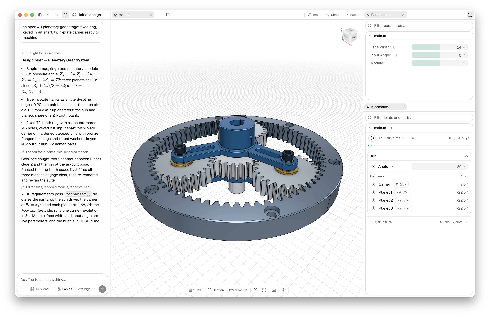

[](license)
[](https://discord.gg/6pfSAN3t7A)
[](https://nodejs.org)

# Tau

The AI-native CAD platform — open-source, browser-based, and kernel-agnostic. Design parts in code, check the geometry, and export.

Star this repository if you want the browser kernels to keep going.

## Start here

1. **Browser.** Open the Replicad planetary-gear example: [tau.new/s/builtin~replicad.planetary-gear-system](https://tau.new/s/builtin~replicad.planetary-gear-system).
2. **Agent plugin**, for Claude Code and Codex, from [taucad/marketplace](https://github.com/taucad/marketplace). Node.js 24 ships the npm 11 this install needs. npm 10 cannot install the CLI. Start a new session or thread after installing.

```bash
npm install -g @taucad/cli@beta
tau --version

# Claude Code 2.1.292 or later
claude plugin install tau --marketplace taucad/marketplace

# Codex
codex plugin marketplace add taucad/marketplace
codex plugin add tau@taucad
```

Ask for a 40 mm wall bracket with two M4 holes, in Replicad, with GeoSpec tests and a screenshot. The plugin page is [docs.tau.new/editor/agent-plugin](https://docs.tau.new/editor/agent-plugin/).

3. **Desktop.** Tau Desktop runs Build123d, and PicoGK on macOS arm64 only. PicoGK is not a browser kernel. The archives at `downloads.tau.new/latest` returned HTTP 404 on 27 October 2026, so this page does not link them.

<picture>
  <source media="(prefers-color-scheme: dark)" srcset="docs/assets/tau-desktop-dark.webp">
  <source media="(prefers-color-scheme: light)" srcset="docs/assets/tau-desktop-light.webp">
  
</picture>

## Features

- **Open Source** — Apache-2.0 across the complete Tau codebase (see [Licensing](docs/licensing/overview.md))
- **Browser** — The browser kernels below run with no install. Desktop is a separate app.
- **Code-based CAD** — Precise, version-controlled designs through code
- **Credits** — Hosted AI uses credits: 100 per US$1. Pro is US$20 per month, plus tax, and includes 2,000 credits. Free includes the local kernels and exports. Zoo (KCL) is Pro and metered.
- **Parametric editor** — Adjustable parameters with a live preview
- **Several kernels** — Pick the engine that matches the part. The Implemented column is what Tau runs today. Planned is not available.
- **Geometry checks** — [GeoSpec](https://github.com/taucad/geospec) checks geometry: size, clearance, and validity. It is not finite-element analysis or design-for-manufacture. Those are roadmap. See Planned.
- **Embeddable** — The [runtime quick start](https://docs.tau.new/runtime/getting-started/quick-start/) is for embedding CAD in your own application.
- **Runs outside Tau** — Every project keeps its ecosystem's own files (`package.json`, `pyproject.toml`, a `.csproj`), so it runs with `npm ci`, `uv`, `dotnet`, OpenSCAD or the Zoo CLI; the standalone-project jobs ([Linux](https://github.com/taucad/tau/actions/workflows/ci.yml?query=branch%3Amain), [macOS](https://github.com/taucad/tau/actions/workflows/native-darwin.yml?query=branch%3Amain); sources [ci.yml](.github/workflows/ci.yml), [native-darwin.yml](.github/workflows/native-darwin.yml)) check each template against Tau's own export on every push to `main`

## Use cases

- **3D printing** — Design and export to STL, 3MF, and slicer-compatible formats
- **Game development** — Create 3D models for games and simulations
- **Industrial design** — Create 3D models for industrial design and manufacturing
- **CAD prototyping** — Parametric code with version control and instant iteration
- **Academic research** — Kernel APIs for computational geometry and educational tools

## Supported integrations

Implemented is what Tau runs today. Planned is not available. Do not read a Planned name as a kernel you can open.

| Category       | Type | Implemented                                                                                                                                                                                                                                                                                                                                                                                                                                                                                                                                                                                                                                                                                                                                     | Planned                                                                                                                                                                                          |
| -------------- | ---- | ----------------------------------------------------------------------------------------------------------------------------------------------------------------------------------------------------------------------------------------------------------------------------------------------------------------------------------------------------------------------------------------------------------------------------------------------------------------------------------------------------------------------------------------------------------------------------------------------------------------------------------------------------------------------------------------------------------------------------------------------- | ------------------------------------------------------------------------------------------------------------------------------------------------------------------------------------------------ |
| **Mechanical** | CAD  | • [OpenSCAD](./packages/plugins/openrscad) (browser)<br>• [Replicad](https://replicad.xyz/) (browser)<br>• [Manifold](https://github.com/elalish/manifold) (browser)<br>• [JSCAD](https://openjscad.xyz/) (browser)<br>• [OpenCascade](https://github.com/taucad/opencascade.js) ([libcascade](https://www.npmjs.com/package/libcascade)) (browser)<br>• [PicoVoxel](https://github.com/taucad/picovoxel) (browser)<br>• [SMLib](./packages/plugins/smlib) (browser)<br>• [Zoo (KCL)](https://zoo.dev/) (browser, Pro, metered)<br>• [Build123d](https://github.com/gumyr/build123d) (desktop)<br>• [SMLibPy](./packages/plugins/smlibpy) (desktop and CLI)<br>• [PicoGK](https://github.com/leap71/PicoGK) (macOS arm64 only, not the browser) | • [Onshape](https://www.onshape.com/)<br>• [Fusion 360](https://www.autodesk.com/products/fusion-360)<br>• [Curv](https://github.com/curv3d/curv)<br>• [Truck](https://github.com/ricosjp/truck) |
|                | Sim  | —                                                                                                                                                                                                                                                                                                                                                                                                                                                                                                                                                                                                                                                                                                                                               | • [FEAScript](https://feascript.com/)                                                                                                                                                            |
| **Electrical** | CAD  | • [tscircuit](https://tscircuit.com/) (browser)                                                                                                                                                                                                                                                                                                                                                                                                                                                                                                                                                                                                                                                                                                 | • [Atopile](https://atopile.io/)                                                                                                                                                                 |
|                | Sim  | —                                                                                                                                                                                                                                                                                                                                                                                                                                                                                                                                                                                                                                                                                                                                               | • [ngspice](https://ngspice.sourceforge.io/)<br>• [CircuitJS](https://www.falstad.com/circuit/)                                                                                                  |
| **Firmware**   | CAD  | —                                                                                                                                                                                                                                                                                                                                                                                                                                                                                                                                                                                                                                                                                                                                               | • [Arduino](https://www.arduino.cc/)<br>• [MicroPython](https://micropython.org/)                                                                                                                |
|                | Sim  | —                                                                                                                                                                                                                                                                                                                                                                                                                                                                                                                                                                                                                                                                                                                                               | • [QEMU](https://www.qemu.org/)<br>• [Wokwi](https://wokwi.com/)                                                                                                                                 |

PicoGK is not a browser kernel. PicoVoxel is the browser voxel kernel. SMLib is the ClassCAD NURBS kernel in the browser. SMLibPy is that kernel in Python, on the desktop and the CLI, not in the browser.

## File converter

The in-app converter imports **38 extensions** and writes **17 outputs**.

Imports are Assimp's 30 mesh extensions, plus GLB, glTF, STEP, STP, IGES, IGS, BREP, and 3DM.

Outputs are GLB, 13 mesh formats written from GLB (3DS, 3MF, DAE, FBX, glTF, OBJ, PLY, STEP, STL, USDA, USDZ, X, and X3D), and PNG, WebP, and JPEG renders.

[libassimp](https://github.com/taucad/libassimp) upstream lists a larger catalog. Tau registers the 30 extensions and 13 mesh targets above, not that larger list. A mesh STEP file is not an exact boundary representation.

## Tau packages

- [opencascade.js / libcascade](https://github.com/taucad/opencascade.js)
- [PicoVoxel](https://github.com/taucad/picovoxel)
- [NanoRaster](https://github.com/taucad/nanoraster)
- [libassimp](https://github.com/taucad/libassimp)
- [GeoSpec](https://github.com/taucad/geospec) — geometry checks, not finite-element analysis
- [marketplace](https://github.com/taucad/marketplace) — the Claude Code and Codex plugin catalog

## Community

- **Discord** — [Join our community](https://discord.gg/6pfSAN3t7A)
- **Documentation** — [docs.tau.new](https://docs.tau.new/)
- **GitHub Discussions** — Ask questions and share ideas

## Contributing

We welcome contributions! Please see our [Contributing Guide](.github/CONTRIBUTING.md) for development setup and guidelines.

## Security

For security concerns, please review our [Security Policy](.github/SECURITY.md).

## Code of Conduct

Please read our [Code of Conduct](.github/CODE_OF_CONDUCT.md) before participating.

## Built with

Tau is built on these open-source projects:

| Category             | Technologies                                                                                                                                                                                   |
| -------------------- | ---------------------------------------------------------------------------------------------------------------------------------------------------------------------------------------------- |
| **State Management** | [XState v6](https://stately.ai/docs)                                                                                                                                                           |
| **UI Framework**     | [React 19](https://react.dev/), [React Router](https://reactrouter.com/), [Radix UI](https://www.radix-ui.com/), [shadcn/ui](https://ui.shadcn.com/), [Tailwind CSS](https://tailwindcss.com/) |
| **Workspace Layout** | [Dockview](https://dockview.dev/)                                                                                                                                                              |
| **Code Editor**      | [CodeMirror](https://codemirror.net/), [Shiki](https://shiki.style/)                                                                                                                           |
| **3D Rendering**     | [Three.js](https://threejs.org/), [React Three Fiber](https://r3f.docs.pmnd.rs/)                                                                                                               |
| **AI Agents**        | [Pi](https://github.com/earendil-works/pi), [AI SDK](https://ai-sdk.dev/)                                                                                                                      |
| **API**              | [NestJS](https://nestjs.com/), [Fastify](https://fastify.dev/), [Better Auth](https://www.better-auth.com/)                                                                                    |
| **Database**         | [Drizzle ORM](https://orm.drizzle.team/)                                                                                                                                                       |
| **Git Operations**   | [Isomorphic Git](https://isomorphic-git.org/)                                                                                                                                                  |
| **Desktop**          | [Electron](https://www.electronjs.org/)                                                                                                                                                        |

Special thanks to [OpenSCAD Playground](https://github.com/openscad/openscad-playground) for inspiring the browser-based code-CAD architecture.

## License

All Tau-authored code is **[Apache-2.0](license)**, including the applications, internal libraries, tools, examples,
published packages, and the GeoSpec engine. It may be forked, modified, embedded, hosted, and redistributed, including
commercially, subject to the Apache licence and notice requirements.

See **[Licensing](docs/licensing/overview.md)** for repository-wide details, previous-release treatment, and third-party notices.

Full third-party license inventory: [third-party licenses](docs/licensing/third-party-licenses.md).
